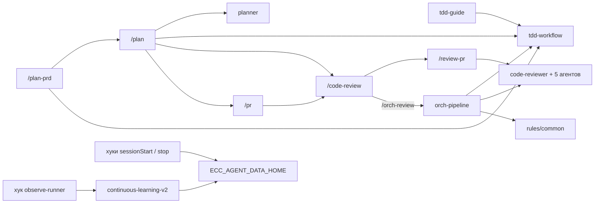
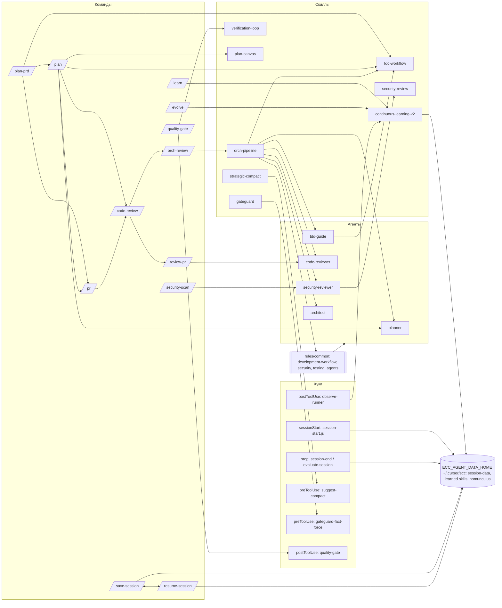

# ECC: карта разрыва Claude Code → Cursor

Что ECC даёт Claude Code и чего не хватает в Cursor, как это связано, и как упаковать форк в полноценный Cursor Plugin. Готовые промпты для Cursor по фазам.

> Markdown-экспорт страницы «ECC: карта разрыва Claude Code → Cursor» (Grok Bot Page) от 19.11.2026. Положи в docs/cursor-plugin/ и упоминай как @docs/cursor-plugin/ECC-CURSOR-GAP-MAP.md.

Источники:

- <https://github.com/affaan-m/ECC> (main @ 3f14a103, 2026-11-17)
- <https://github.com/balloutcode/ecc-cursor> (пересоздан пустым 2026-11-19 19:35 МСК)
- <https://cursor.com/docs/plugins>
- <https://cursor.com/docs/reference/plugins>
- <https://cursor.com/help/ai-features/multi-agent>

## Содержание

- Главное
- Репозиторий ecc-cursor
- Cursor Plugin: факты
- Multitask
- Инвентарь разрыва
- Матрица возможностей
- Хуки
- Карта зависимостей
- Нейтрализация Claude-специфики
- Исключения других платформ
- Архитектура форка-плагина
- Фазы и Done-when
- Режимы и модели
- Промпты
- Источники и покрытие

## Главное

Форк поставляется как Cursor Plugin «ecc-cursor». Его ставят через Customize → Plugins, а не скриптом в папку проекта. Плагин собирается из исходников ECC: сборщик переводит каждый компонент в формат Cursor и пропускает всё, что относится к другим платформам. Сам репозиторий ECC при этом не меняется, поэтому слияние с upstream остаётся простым.

По числу файлов официальный --target cursor почти совпадает с установкой для Claude Code: 1388 операций против 1397 (dry-run, профиль full, коммит 3f14a103). Разрыв в том, что файлы копируются без перевода форматов, а из 49 скриптов хуков Cursor запускает 16.

| Значение | Что | Пояснение |
| --- | --- | --- |
| 82 из 121 | правил неактивны | Claude-формат paths: |
| 72 из 72 | агента с Claude frontmatter | model sonnet/opus/haiku, tools |
| 16 из 49 | скриптов хуков доступны | 21 поведенческий хук не перенесён |
| 33 | команды с $ARGUMENTS | 70 вхождений |
| ≈620 | файлов других платформ | не попадают в плагин |
| 0 | правок upstream (цель) | всё в слое cursor-plugin |

> **Почему плагин, а не install.ps1.** Плагин виден и управляется в Customize, ставится на пользователя или проект, обновляется через Refresh или Auto Refresh и чисто удаляется. Он не засоряет проекты копиями 1388 файлов. Upstream-цель --target cursor остаётся как есть, но не используется. Свою install-цель не делаем. Для разработки плагин копируется в ~/.cursor/plugins/local/ecc-cursor, в CLI можно запускать с --plugin-dir.

## Репозиторий balloutcode/ecc-cursor

_Проверено через GitHub API 19.11.2026 в 19:40 (МСК), после пересоздания репозитория._

| Что | Факт | Что из этого следует |
| --- | --- | --- |
| Тип | Публичный, пересоздан 19.11.2026 19:35 (МСК); fork: false, parent нет | Это не GitHub-fork: кнопки «Sync fork» нет, синхронизация через remote upstream и git merge |
| Содержимое | Полностью пустой: ни коммитов, ни файлов; default branch main | Импорт ECC нужен до фазы 0, иначе @-пути не работают (Шаг 0) |
| Лицензия | Нет. Upstream — MIT, © 2026 Affaan Mustafa | LICENSE приходит из upstream; уведомление сохраняется в репо и в плагине; в plugin.json license MIT |
| Upstream | affaan-m/ECC main = 3f14a103 (17.11.2026 09:41 МСК), ~5 000 коммитов, 20+ тегов v\* | main создаётся из upstream/main (checkout -b) и пушится: без merge, конфликтов и force-push |
| README | Корневой README — от upstream | Не трогаем; README форка — в .github/README.md: GitHub показывает его первым (.github → корень → docs) |
| Теги | release.yml запускается на push тегов v\* и публикует npm (NPM_TOKEN) | Теги upstream не пушить (fetch --no-tags); теги плагина — ecc-cursor-v&lt;semver> |
| Workflows upstream | discussion/release-announce, issue-submission-guard, pr-burst-guard, release, reusable-release, slsa-publish нужны секреты; maintenance и monthly-metrics по расписанию пишут issues | Отключить в Actions → Disable workflow, файлы не править; ci.yml, npmscan, taste-skills, supply-chain-watch оставить |
| Ветки | main; cursor-plugin/phase-N; cursor-plugin-dist | Импорт: Customize → Plugins → From GitHub Repository → <https://github.com/balloutcode/ecc-cursor>; CLI: agent plugin marketplace add … --git-ref cursor-plugin-dist. Выбор ветки в IDE — TODO(verify), запасной путь — репо ecc-cursor-dist |

### Шаг 0 — импорт ECC в репозиторий (один раз, до фазы 0)

Подготовка (руками, 1 минута):
1. Сохрани `ECC-CURSOR-GAP-MAP.md` в `C:\Users\<user>\Downloads\`.
2. В Cursor: File → Open Folder → `C:\Users\<user>\Documents\CursorRepos\ecc-cursor` (папка уже создана).
3. Новый чат, режим Agent, модель Kimi K3 (High хватит). Вставь промпт ниже. ОБЩИЕ ПРАВИЛА здесь не нужны.
4. Когда агент закончит, в этой же папке открывай новый чат в Plan Mode — фаза 0.

```text
Задача: один раз импортировать ECC в мой пустой репозиторий github.com/balloutcode/ecc-cursor. Только git и npm,
никаких правок файлов кроме копирования одного документа. Windows, PowerShell.
Рабочая папка — текущая: C:\Users\<user>\Documents\CursorRepos\ecc-cursor. Она уже существует.

Жёсткие правила:
- Работай ТОЛЬКО в этой папке. Никаких других клонов и папок (C:\dev, временных клонов, worktree) не создавать.
- Без --force, без --tags, без push в upstream. Теги upstream не скачивать (--no-tags): тег v* в моём репо запустит
  npm-релиз.
- Если любая команда падает не так, как описано ниже, — остановись и покажи мне вывод, не импровизируй.

Сначала проверь состояние папки (Get-ChildItem -Force; git status; git remote -v) и выбери ОДИН вариант:
А) Папка пустая (нет .git и файлов):  git clone https://github.com/balloutcode/ecc-cursor.git .
   (точка в конце — клон в текущую папку; «cloned an empty repository» — норма)
Б) Уже есть .git, origin = https://github.com/balloutcode/ecc-cursor(.git), коммитов нет — клонировать не нужно, иди дальше.
В) Что-то другое (есть файлы, коммиты, другой origin) — остановись и покажи мне вывод.

Дальше (по одной команде, проверяя вывод):
git remote add upstream https://github.com/affaan-m/ECC.git
git remote set-url --push upstream DISABLE                    # защита от push в upstream
git fetch upstream main --no-tags
git checkout -b main upstream/main                            # «upstream is gone» — норма, репо пустой
git push -u origin main                                       # теперь main отслеживает origin/main
New-Item -ItemType Directory -Force docs\cursor-plugin
Copy-Item C:\Users\<user>\Downloads\ECC-CURSOR-GAP-MAP.md docs\cursor-plugin\
git add docs/cursor-plugin/ECC-CURSOR-GAP-MAP.md
git commit -m "docs(cursor-plugin): gap map"
git push
npm ci
npm test

Done when:
- git remote -v: origin = balloutcode/ecc-cursor (fetch и push), upstream push = DISABLE;
- git log --oneline -3: сверху мой коммит gap map, под ним 3f14a103 (или новее, если upstream обновился);
- git status -sb: «## main...origin/main» без ahead/behind; git tag пустой;
- npm test: если есть падения — НЕ чини их, просто перечисли (это базовая линия upstream на Windows).
Отчёт: вывод этих четырёх проверок и итог npm test (сколько прошло/упало, названия упавших).
```

После отчёта (руками в GitHub): Actions → отключи workflows (список в строке «Workflows upstream» выше) (кнопка «Disable workflow»), файлы не правим.

## Cursor Plugin: проверенные факты

_По cursor.com/docs/plugins, /reference/plugins, /customize-cursor, /hooks, /skills, /rules, help/customization/plugins, marketplace-security и CLI changelog (19.11.2026)._

| Тема | Что известно | Что значит для ECC |
| --- | --- | --- |
| Формат | Cursor Plugin: .cursor-plugin/plugin.json; несёт rules, skills, agents, commands, hooks, MCP, variables. Agent Plugins (корневой plugin.json) несёт только skills и MCP | Нужен Cursor Plugin: только он даёт правила, агентов, команды и хуки |
| Манифест | Обязательно только name (kebab-case). Есть version, description, author, logo, пути компонентов. Если путь указан, папка по умолчанию не сканируется | Явные пути в манифесте, чтобы в плагин не попали лишние файлы |
| Поиск компонентов | rules/ (.md, .mdc), skills/&lt;name>/SKILL.md, agents/, commands/ (.md, .txt), hooks/hooks.json, mcp.json | Корень ECC для этого не годится: там hooks/hooks.json в формате Claude. Плагин собирается в отдельную папку |
| Агенты | В справке плагинов указаны name и description. Официальные плагины пишут также model, readonly, is_background | model: inherit, readonly для read-only агентов |
| Хуки | Только command-хуки; идут после enterprise, team, project и user. cwd — папка плагина, но stop и subagentStop — корень workspace. Env CURSOR_PLUGIN_ROOT. Windows — PowerShell | Команда хука не должна зависеть от cwd и раскрытия ${…}: node сам читает CURSOR_PLUGIN_ROOT (проверка в фазе 1) |
| MCP | В mcp.json раскрываются ${CURSOR_PLUGIN_ROOT} и ${CLAUDE_PLUGIN_ROOT}. ${VAR} — переменные плагина, значения задаёт админ в дашборде. Серверы видны как plugin-&lt;plugin>-&lt;server> | Каталог из 37 серверов — отдельным опциональным плагином или справочником |
| Установка | Customize → Install, область проекта или пользователя. Customize → From GitHub Repository (нужен .cursor-plugin/marketplace.json). Локально ~/.cursor/plugins/local/&lt;name> + Reload Window; симлинки наружу не грузятся. CLI: --plugin-dir, agent plugin marketplace add &lt;git-url> --git-ref | Основной путь — GitHub-импорт ветки-релиза. Dev-путь — install-local (копия) |
| Команды | Team marketplace: Teams (1) или Enterprise (без лимита); режимы Default Off / Default On / Required; Auto Refresh не чаще раза в 10 минут | Если появится команда на Teams — тот же репозиторий подключается как team marketplace |
| Публичный Marketplace | Только open source, ручное ревью каждой версии, cursor.com/marketplace/publish, чек-лист (пути без .., README, frontmatter, variables) | По желанию. Validate в фазе 1 повторяет этот чек-лист |
| Обновления | Индексация при импорте, затем Refresh или Auto Refresh по push. Запущенный Cloud Agent держит старую версию. Роль поля version не описана | Своя semver + SHA upstream в CHANGELOG |
| Зависимости | Механизма зависимостей между плагинами нет (в Claude Code есть dependencies) | Один плагин ядра; пакеты — только замкнутые по ссылкам |
| Claude-конфиги | Third-Party Imports (включено по умолчанию) подгружает хуки из ~/.claude/settings.json. В CLI «Plugins imported from Claude Code appear alongside native ones» | Имя ecc-cursor вместо ecc; детектор двойной загрузки в sessionStart |

Как это сделано в реальных плагинах. В github.com/cursor/plugin-template пример starter-advanced содержит rules, skills, agents, commands, hooks, mcp.json и scripts. Официальный маркетплейс github.com/cursor/plugins (около 17 тыс. звёзд): у advisor агент с model: grok-4.6[effort=xhigh] и readonly: true и хуки через bash "${CURSOR_PLUGIN_ROOT}/…"; у continual-learning stop-хук через bun. В github.com/EveryInc/compound-engineering-plugin .cursor-plugin лежит в одном репозитории с конфигами других харнессов. У ECC upstream есть .claude-plugin, .codex-plugin, .grok-plugin и .qoder-plugin, а .cursor-plugin нет.

## Multitask

_Исправление: в прошлой версии я ошибочно написал, что такого режима нет._

| Что | Как работает | Источник |
| --- | --- | --- |
| /multitask | Вместо очереди Cursor запускает async-сабагенты параллельно и сам дробит крупную задачу на части для нескольких сабагентов. Сообщения, уже стоящие в очереди, тоже можно отправить в multitask. Cursor 3.2 (24.04.2026), Agents Window; с 3.3 (07.05.2026) и в редакторе | cursor.com/changelog/04-24-26, /05-07-26 |
| Build in Parallel | Кнопка у плана: Cursor находит независимые шаги, запускает их одновременно и сохраняет порядок зависимых | cursor.com/changelog/05-07-26; help/ai-features/multi-agent |
| Изоляция | По умолчанию сабагенты работают в одном checkout и могут перезаписать правки друг друга. Если попросить «each in its own environment», каждый получает свой git worktree или облачную VM со своей веткой, а родитель потом сливает результат | cursor.com/docs/subagents |
| Модель | Сабагенты обычно берут модель родителя (кроме BYOK и request-based pricing); модель можно попросить словами | forum.cursor.com, ответ сотрудника Cursor |
| Ограничения | Это v0, отдельной защиты от конфликтов нет. Каждый сабагент тратит токены отдельно. Вложенность: внук запускать сабагентов не может. Лимит числа сабагентов не документирован | форум; docs/subagents |

В этом форке: Build in Parallel из PLAN.md для фаз 2 и 6 (у них разные файлы). /multitask с изоляцией внутри фаз 2 и 4, где работа делится на пакеты правил и скиллов, а общий трансформер уже готов. Не использовать в фазах 1, 3 и 5: там общий код и цепочки зависимостей.

## Инвентарь разрыва по компонентам

_Числа из dry-run в пустую папку: node scripts/install-apply.js --target cursor|claude-project --profile full --enable-hooks --dry-run --json, коммит 3f14a103. Последние колонки — куда компонент попадает в плагине._

| Компонент | Claude Code в ECC | --target cursor сейчас | Разрыв | Стратегия в плагине | Объём |
| --- | --- | --- | --- | --- | --- |
| Агенты | 72 .md, frontmatter Claude: tools, model | 72 → .cursor/agents/ecc-\*.md как есть | model sonnet 62 / opus 4 / haiku 6; tools не понимается Cursor; readonly нет | transform (эмиттер на agent-ir) → agents/ плагина | M |
| Команды | 98 + 12 legacy-шимов (tdd, e2e, verify…) | 98 → .cursor/commands как есть; шимы не ставятся | $ARGUMENTS в 33; .claude/ в 42; multi-\* (6) через codeagent-wrapper; 12 коллизий имён со скиллами | transform + emulate (multi-\*) → commands/ плагина | L |
| Скиллы | 327 | 325 + 13 Cursor-копий; нет config-health, dmux-workflows | .claude/ в 51 (205 вхождений); ${CLAUDE_PLUGIN_ROOT} в текстах; allowed-tools 2; $ARGUMENTS 2; mcp__ 11 | transform (пути, ссылки) → skills/ плагина | M |
| Правила | 121 в rules/ (frontmatter paths:) + 39 в .cursor/rules | 121 .mdc: 39 нативных, 82 с Claude paths: | 82 правила неактивны (Cursor читает только description/globs/alwaysApply) | transform paths→globs → rules/ плагина | S |
| Контексты | 3 (dev, research, review) через claude --system-prompt | 0 | 3 | emulate: skill как Custom Mode | S |
| Хуки | 8 событий, 28 записей, 49 скриптов достижимо | 15 событий, 16 точек входа, 16 скриптов, 25 hook-id | 21 поведенческий хук не перенесён; 6 событий Cursor не используются; runtime ищется по путям проекта | transform + emulate → hooks/hooks.json плагина | L |
| Память / сессии | session-data, learned skills, homunculus; SessionStart/Stop/PreCompact | ECC_AGENT_DATA_HOME = ~/.cursor/ecc; session-start, stop, pre-compact есть | observe-runner (CLv2) и activity-tracker нет; команды ссылаются на ~/.claude | transform + перенос хуков; данные вне папки плагина | M |
| MCP | .mcp.json (chrome-devtools) + каталог 37 | merge в .cursor/mcp.json (1) + каталог копией | каталог в формате ${VAR}, не активен | mcp.json плагина (минимум) + опц. плагин ecc-cursor-mcp с variables | S |
| Поставка | .claude-plugin (Claude), .codex-plugin, install.sh/ps1 с 19 адаптерами | --target cursor (beta), копирует файлы в .cursor/ проекта | .cursor-plugin нет; нет Customize, обновлений, чистого удаления | сборка Cursor Plugin + ветка-релиз с marketplace.json | M |
| Безопасность / AgentShield | ecc-agentshield, /security-scan, config-protection, gateguard, governance-capture | скиллы есть; sensitive-file хуки только Cursor | config-protection, gateguard, governance-capture не перенесены | перенос хуков | M |
| Проектные файлы | settings.json (hooks, permissions), statusline | нет | плагин не пишет .cursor/cli.json, sandbox.json, .cursorignore, AGENTS.md | скилл /ecc-project-setup по запросу; statusline — impossible в IDE | S |
| Dashboard / ecc2 | ecc_dashboard.py, dashboard-web.js, ecc2 (Rust, 21 файл) | не ставится (инструменты репо) | не поверхность установки | 1:1, запуск из форка | S |
| Scripts | 400 файлов | 301 копируется в .cursor/scripts | в плагин нужен только runtime хуков и скриптов из скиллов | require-граф от хуков + ссылки из скиллов | M |
| AGENTS.md / CLAUDE.md | CLAUDE.md проекта | AGENTS.md намеренно не ставится | так задумано | оставить; по запросу через /ecc-project-setup | — |

## Матрица возможностей Claude Code <-> Cursor

_По официальной документации, скачанной 19.11.2026; копии в /workspace/ecc-cursor-fork/docs-notes/raw/._

| Возможность | Claude Code | Cursor | Вывод для форка |
| --- | --- | --- | --- |
| Сабагенты | `.claude/agents`; поля name, description, tools, disallowedTools, model (sonnet\|opus\|haiku\|fable\|inherit), permissionMode, maxTurns, skills, mcpServers, hooks, memory, background, isolation: worktree, effort, color | `.cursor/agents` или agents/ плагина; поля name, description, model (inherit \| id[params]), readonly, is_background | tools → readonly, model → inherit, остальное в тело или отбросить |
| Скиллы | + when_to_use, argument-hint, arguments, user-invocable, allowed-tools, model, effort, context: fork, agent, hooks, paths, shell; $ARGUMENTS, $N | skills/ плагина, `.cursor/skills`, `~/.cursor/skills`; поля name (= папка), description, paths, disable-model-invocation, metadata; Custom Mode | убрать allowed-tools и $ARGUMENTS; context: fork эмулировать сабагентом |
| Команды | слиты в skills; $ARGUMENTS, argument-hint, allowed-tools, model | commands/ плагина (name, description); /migrate-to-skills → skill с disable-model-invocation | командой без $ARGUMENTS или скиллом |
| Правила / память | CLAUDE.md (+ @imports), `.claude/rules/\*.md` с paths: | rules/ плагина или `.cursor/rules/\*.mdc` (description, globs, alwaysApply); AGENTS.md | paths → globs |
| Хуки: события | 33 события | 21 событие: sessionStart/End, pre/postToolUse, postToolUseFailure, subagentStart/Stop, before/afterShellExecution, before/afterMCPExecution, beforeReadFile, afterFileEdit, beforeSubmitPrompt, preCompact, stop, afterAgentResponse/Thought, Tab ×2, workspaceOpen | у всех 8 событий, которые использует ECC, есть аналог |
| Хуки: типы | command, http, mcp_tool, prompt, agent; async, if, onFailure | command, prompt (в плагинах только command); matcher, timeout, loop_limit, failClosed | async нет → скрипты быстрые или отсоединяются |
| Хуки: output | hookSpecificOutput.permissionDecision, updatedInput, additionalContext | permission, user_message, agent_message, updated_input; additional_context в postToolUse и sessionStart; followup_message в stop | адаптер переводит форматы |
| Инструменты | Bash, PowerShell, Read, Write, Edit, MultiEdit, Glob, Grep, Task, WebFetch, mcp__s__t | Shell, Read, Write, Grep, Delete, Task, MCP:&lt;tool>; Glob нет | tool-map + тест |
| MCP | `.mcp.json`; ${VAR} | `.cursor/mcp.json`: ${env:VAR}, ${workspaceFolder}; в плагине: ${VAR} = variables, ${CURSOR_PLUGIN_ROOT} | конвертер синтаксиса |
| Плагины | `.claude-plugin/plugin.json`, userConfig, dependencies, marketplace.json | `.cursor-plugin/plugin.json`, variables (для админа), marketplace.json; зависимостей нет | userConfig hook_profile → ~/.cursor/ecc/config.json |
| Права | settings.json permissions | CLI `.cursor/cli.json`; IDE Run Modes, sandbox.json | скилл /ecc-project-setup |
| Env | CLAUDE_PROJECT_DIR, CLAUDE_PLUGIN_ROOT | CURSOR_PROJECT_DIR, CURSOR_PLUGIN_ROOT, CURSOR_TRANSCRIPT_PATH, CLAUDE_PROJECT_DIR (alias) | run.js выставляет CLAUDE_PLUGIN_ROOT для старых скриптов |

## Хуки

| Claude (matcher) | Cursor | Есть в адаптере | Не перенесено | Фолбэк / заметка |
| --- | --- | --- | --- | --- |
| SessionStart | sessionStart | session:start (+ cursor-session-env) | plan-canvas-sessions | env + additional_context; здесь же детектор двойной загрузки |
| UserPromptSubmit | beforeSubmitPrompt | только Cursor: secret-warning | hookify-runtime (prompt), context-gate | контекст не вставить → sessionStart / postToolUse.additional_context |
| PreToolUse (Bash) | beforeShellExecution | block-no-verify, dev-server-block, git-push-reminder, tmux-reminder | commit-quality, gateguard (bash), auto-tmux-dev | tmux-хуки выключены на win32 |
| PreToolUse (PowerShell) | beforeShellExecution | — | gateguard (powershell) | через адаптер |
| PreToolUse (Write\|Edit\|MultiEdit) | preToolUse matcher Write | — | doc-file-warning, suggest-compact, config-protection, gateguard, governance-capture | deny + updated_input |
| PreToolUse (^mcp__) | beforeMCPExecution / preToolUse MCP:\* | только Cursor: mcp audit | mcp-health-check | — |
| PreToolUse (.\*) | preToolUse \* | — | observe (CLv2), hookify-runtime | async нет |
| PostToolUse (.\*) | postToolUse / afterFileEdit / afterShellExecution | edit accumulator, console-warn, design-quality, build-complete, pr-created | context-monitor, metrics-bridge, governance, hookify, observe, quality-gate, activity-tracker, command-log | additional_context |
| PostToolUseFailure | postToolUseFailure | — | mcp-health-check, skill-run-tracker | matcher Skill нет → afterAgentResponse + transcript (TODO verify) |
| PreCompact | preCompact | pre:compact | — | только наблюдение |
| Stop | stop (cwd = workspace) | check-console-log, cost-tracker, evaluate-session, format-typecheck, session-end | hookify (stop), plan-canvas-pending, desktop-notify | followup_message, loop_limit |
| SessionEnd | sessionEnd | session:end:marker | — | ок |

В плагине каждая запись hooks.json вызывает одну точку входа run.js с именем события. Путь к плагину run.js берёт из CURSOR_PLUGIN_ROOT, а не из cwd: у stop и subagentStop cwd — корень workspace. Для старых скриптов ECC run.js выставляет CLAUDE_PLUGIN_ROOT и ECC_PLUGIN_ROOT, поэтому scripts/hooks можно переиспользовать без правок. Из scripts/lib только Claude-хуками используются 20 модулей, в том числе весь gateguard-\*, hook-flags и windows-bash.

## Карта зависимостей

_Связи найдены grep-ом по точным именам агентов, скиллов и /команд; хуки — по require._



| Источник | → агенты | → скиллы | → команды | → скрипты | → правила |
| --- | --- | --- | --- | --- | --- |
| 98 команд | 52 связи в 31 | 65 в 48 | 133 в 61 | 26 в 25 | — |
| 327 скиллов | 112 в 37 | 632 в 184 | 80 в 28 | 59 в 35 | 46 в 11 |
| 72 агента | 39 в 17 | 70 в 40 | 11 в 7 | — | — |
| 122 файла rules/ | 29 в 11 | 91 в 59 | 1 в 1 | — | — |

Чаще всего упоминаются агенты security-reviewer (31), code-reviewer (23), planner (18), tdd-guide (15), architect (13) и скиллы accessibility (35), security-review (35), verification-loop (30), tdd-workflow (27). Механизма зависимостей между плагинами в Cursor нет, поэтому эти связи должны замыкаться внутри одного плагина. Если делить на ядро и пакеты, каждый пакет может ссылаться только на себя или на ядро; check-links проверяет это при сборке.

| Группа | Состав | Зависит от | Фаза |
| --- | --- | --- | --- |
| G0 Сборка | сборщик, exclusions, манифест, validate, check-links, пробный хук | — | 1 |
| G1 Правила + контексты | 121 правило, 3 контекста | G0 | 2 (параллельно с 6) |
| G2 Агенты | 72 агента + ссылки в 11 правилах | G0, G1 | 3 |
| G3 Скиллы | ~325 скиллов + скрипты, на которые они ссылаются | G2 (agent-names) | 4 |
| G4 Команды и цепочки | 98 команд, plan-prd → pr, multi-\* | G2, G3 | 5 |
| G5 Хуки | hooks.json плагина, run.js, runtime scripts | G0 | 6 (параллельно с 2) |
| G6 Память и CLv2 | хуки сессий + команды и скиллы памяти | G3, G4, G5 | 7 |
| G7 MCP, проектная настройка, поставка, CI | mcp, /ecc-project-setup, ветка-релиз, CI | все | 8 |



## Нейтрализация Claude-специфики

_Число файлов и вхождений на 3f14a103._

| Что | Файлов | Вхождений | Чем заменить |
| --- | --- | --- | --- |
| model: в агентах (sonnet 62, opus 4, haiku 6) | 72 | 72 | model: inherit |
| tools: в агентах | 72 | 72 | readonly: true для read-only |
| sonnet/opus/haiku в тексте | 98 | 129 | «основная модель» |
| $ARGUMENTS в командах / скиллах | 33 / 2 | 70 / 3 | «текст после /команды» |
| allowed-tools (команды 2, скиллы 2) | 4 | 4 | удалить, перенести в тело |
| .claude/ в командах / скиллах | 42 / 51 | 165 / 205 | path-map |
| .claude/ в правилах / агентах / scripts/hooks | 18 / 3 / 13 | 34 / 4 / 41 | path-map, ECC_AGENT_DATA_HOME |
| ${CLAUDE_PLUGIN_ROOT} в текстах agents/commands/skills/rules | 20 | 54 | путь внутри плагина через ECC_PLUGIN_ROOT |
| ~/.claude/settings.json | — | 28 | по смыслу |
| ~/.claude/bin/codeagent-wrapper | 6 команд | 16 | сабагенты плагина |
| CLAUDE.md | 36 | 105 | AGENTS.md / правило |
| Task tool / subagent_type | 12 | 21 | «делегируй сабагенту ecc-X» |
| «Claude Code» в тексте | 85 | 178 | «агент» / «Cursor» |
| CLAUDE_\* env в scripts/ | 71 | 208 | run.js выставляет совместимые env |
| TodoWrite / WebFetch / WebSearch / NotebookEdit / MultiEdit | 16 | 42 | нейтральные имена |
| mcp__ имена инструментов | 11 | 32 | MCP:&lt;tool> |

## Исключения других платформ

| Что исключаем | Файлов | Как |
| --- | --- | --- |
| .kiro, .opencode, pi/, .agents | 155 + 85 + 223 + 119 | сборщик пропускает по exclusions.json |
| .codex, .codex-plugin, .codebuddy, .gemini, .grok-plugin, .hermes, .kimi, .openclaw, .pi, .qoder-plugin, .qwen, .trae, .zed, .adal, hooks/hermes | 38 | то же |
| скрипты codex/, codex-git-hooks/, sync-ecc-to-codex.sh, orchestrate-codex-worker.sh, build-opencode.js, build-pi-core.js, \*-adapt-agents.js, grok-install.js | 11 путей | не попадают в runtime (require-граф) |
| scripts/lib: agent-emit-pi, antigravity-\*, codex-\*, grok-\*, opencode-paths | 9 | то же |
| скиллы hermes-imports, openclaw-persona-forge, deepseek-harness-setup | 3 | не собирать (сверить в фазе 0) |
| multi-\* команды (codeagent-wrapper → codex/antigravity) | 6 | переписать на сабагентов |
| тесты чужих платформ | около 50 | оставить: upstream должен быть зелёным |

Из репозитория ничего не удаляется: исключение происходит только при сборке плагина. В main нет сгенерированных файлов, поэтому markdownlint и валидаторы upstream их не видят, а merge с upstream не даёт конфликтов.

## Архитектура форка-плагина

```text
github.com/balloutcode/ecc-cursor, ветка main = история upstream affaan-m/ECC (merge) + слой сборки
(сгенерированного в main нет, кроме docs/cursor-plugin/reference/ с проверкой --check)
├── cursor-plugin/                          (новый) исходники слоя
│   ├── plugin.template.json                манифест .cursor-plugin/plugin.json
│   ├── maps/  exclusions.json  agent-names.json  path-map.json  tool-map.json  hook-map.json
│   ├── overrides/  agents/ skills/ commands/ rules/   ручные правки поверх генерации
│   └── hooks-src/  run.js  adapter-full.js  probe.js
├── scripts/cursor-plugin/                  (новый) build.js validate.js check-links.js generate-hooks.js
│                                           install-local.js publish-branch.js
├── scripts/lib/cursor-plugin/              (новый) transforms.js rules.js agent-emit-cursor.js skills.js commands.js
├── tests/cursor-plugin/*.test.js           (новый) подхватывается tests/run-all.js
├── docs/cursor-plugin/  ECC-CURSOR-GAP-MAP.md  PLAN.md  VERIFY.md  UPSTREAM.md  UPSTREAM-TOUCHES.md  SYNC.md
│   ├── HOOKS.md DIFFERENCES.md MULTITASK.md TROUBLESHOOTING.md CONTRIBUTING.md CHANGELOG.md   (фаза 9)
│   └── reference/  agents skills commands rules hooks mcp excluded .md   (GENERATED gen-docs.js)
├── .github/README.md                       (новый) витрина репо вместо корневого README upstream
└── .github/workflows/cursor-plugin.yml     (новый) windows-latest + ubuntu-latest, job docs

build/cursor-plugin/ecc-cursor/             результат сборки (build/ уже в .gitignore)
├── .cursor-plugin/plugin.json              name "ecc-cursor", явные пути компонентов
├── rules/*.mdc                             121 правило с globs/alwaysApply
├── agents/ecc-*.md                         72 агента: model: inherit, readonly
├── skills/<name>/SKILL.md                  ~325 скиллов + 3 контекста как Custom Mode
├── commands/*.md                           98 команд без $ARGUMENTS
├── hooks/hooks.json + hooks/run.js         события Cursor, node читает CURSOR_PLUGIN_ROOT сам
├── scripts/hooks, scripts/lib              только файлы, достижимые по require от хуков
├── mcp.json                                минимум (по PLAN.md)
└── assets/logo.svg, README.md, CHANGELOG.md

Ветка-релиз cursor-plugin-dist (orphan, пишет publish-branch.js; теги ecc-cursor-v<semver>, не v*)
├── .cursor-plugin/marketplace.json         plugins: [{ name: "ecc-cursor", source: "./ecc-cursor" }]
└── ecc-cursor/                             копия сборки
```

1. **Сборка вместо установки.** build.js берёт профиль full из manifests/install-profiles.json, применяет трансформы и кладёт готовый плагин в build/cursor-plugin/ecc-cursor/. Переиспользуются agent-ir.js и логика имён из cursor-project.js; upstream-файлы не меняются.
2. **Явные пути в манифесте.** plugin.json перечисляет rules, agents, skills, commands, hooks. Тогда Cursor не будет сканировать папки по умолчанию.
3. **Хуки без зависимости от шелла.** Каждая запись вызывает node, который сам читает CURSOR_PLUGIN_ROOT. Фаза 1 проверяет на Windows, как работают обе формы команды.
4. **Поставка веткой-релизом.** publish-branch.js пишет ветку cursor-plugin-dist: .cursor-plugin/marketplace.json и папка ecc-cursor. Её импортируют через Customize → From GitHub Repository. Можно ли выбрать ветку при импорте — TODO(verify); запасной вариант — отдельный репозиторий.
5. **Dev-цикл.** cursor-plugin:build → cursor-plugin:install-local (копия в ~/.cursor/plugins/local/ecc-cursor) → Developer: Reload Window. В CLI: agent --plugin-dir build/cursor-plugin/ecc-cursor.
6. **Проектные файлы по запросу.** Плагин не пишет в проект. Скилл /ecc-project-setup создаёт .cursor/cli.json, sandbox.json, .cursorignore и AGENTS.md, когда пользователь его вызывает.
7. **Upstream sync.** git fetch upstream --no-tags && git merge upstream/main → пересборка → тест на дрейф: новые агенты, скиллы или hook-id без записи в картах роняют CI.
8. **Документация без дрейфа.** gen-docs.js пишет справочник агентов, скиллов, команд, правил, хуков и MCP из собранного плагина; cursor-plugin:docs:check в CI падает, если доки отстали. Проза — .github/README.md и docs/cursor-plugin/\*.md (фаза 9).

## Фазы и Done-when

| Фаза | Что | Режим Cursor | Модель | Зависит | Done-when (кратко) |
| --- | --- | --- | --- | --- | --- |
| 0 | Изучение и PLAN.md | Plan Mode | Kimi K3; вторая проверка GPT-5.6 Sol | — | PLAN.md с 12 разделами, вопросы заданы |
| 1 | Сборка, манифест, validate, check-links, пробный хук, install-local | Agent | Kimi K3 или GPT-5.6 Sol | 0 | плагин виден в Customize; probe.log на Windows; npm test зелёный |
| 2 | Правила + контексты | Build in Parallel (с 6); внутри /multitask с изоляцией | Grok 4.7 (high) | 1 | N/N нативный frontmatter |
| 3 | Агенты (эмиттер) | Agent; /best-of-n | Kimi K3 / GPT-5.6 Sol / Grok 4.7 | 1, 2 | 72/72; 0 Claude-моделей; агенты в Customize |
| 4 | Скиллы | Agent + /multitask с изоляцией | Grok 4.7 или Kimi K3 | 3 | 0 битых ссылок, 632 связи |
| 5 | Команды и цепочки | Agent | Kimi K3 | 3, 4 | check-links fail-режим зелёный |
| 6 | Хуки плагина | Build in Parallel (с 2) / worktree | Kimi K3 или GPT-5.6 Sol | 1 | 49/49: перенесено или impossible; block-no-verify работает |
| 7 | Память и CLv2 | Agent | Kimi K3 | 4, 5, 6 | e2e двух сессий на win32; обновление не стирает память |
| 8 | MCP, /ecc-project-setup, ветка-релиз, CI, sync | Agent (+ Cloud для Linux CI) | Grok 4.7 / Composer 2.5 | все | установка из GitHub-ветки, Refresh приносит новую версию |
| 9 | Документация: README, справочник из сборки, хуки, отличия, Multitask, troubleshooting, CONTRIBUTING, CHANGELOG, docs-CI | Agent (проза можно /multitask с изоляцией) | Kimi K3 или GPT-5.6 Sol | 8 | docs:check без diff; lint и ссылки 0 ошибок; числа README = report.json |

## Режимы и модели

| Режим Cursor | Когда использовать здесь | Источник |
| --- | --- | --- |
| Plan Mode (Shift+Tab) | Фаза 0 и любые развилки. План сохраняется в репо через «Save to workspace» | cursor.com/docs/agent/plan-mode |
| Agent | Фазы 1–9: правки, сборка, тесты, документация. Одна фаза = один чат = одна ветка | cursor.com/docs/agent/overview |
| Build in Parallel | Из PLAN.md запустить независимые фазы 2 и 6 одновременно; зависимые Cursor держит по порядку | cursor.com/changelog/05-07-26 |
| /multitask | Внутри фаз 2 и 4: пакеты правил и скиллов, «each in its own environment», общий трансформер готов заранее. Не для фаз 1, 3, 5 | cursor.com/changelog/04-24-26; docs/subagents |
| /worktree, /best-of-n | Изолировать фазу целиком; эмиттер агентов и адаптер хуков на 2–3 моделях с выбором лучшего | cursor.com/docs/configuration/worktrees |
| Cloud Agents / Projects | Только Linux-часть (CI, сборка) после фазы 1. Проверки на Windows локально. Projects — тариф Premium+ | cursor.com/docs/agent/projects |

| Модель в Cursor | Что подтверждено | $/1M (вход / кэш / выход) | Роль здесь |
| --- | --- | --- | --- |
| Kimi K3 (Moonshot) | Есть в Cursor, скрыта по умолчанию; до 1M токенов без надбавки; Cursor называет её открытой моделью с самым высоким CursorBench | 3 / 0.3 / 15 | Планирование, хуки, связи; родитель для /multitask |
| GPT-5.6 Sol | Флагман; Cursor отмечает склонность злоупотреблять сабагентами и ждать явного «делай» | 4 / 0.4 / 20 (промо до 21.11) | Вторая проверка плана, /best-of-n |
| Grok 4.7 | В пуле Cursor; 256k (500k long); effort xhigh/high/medium/low | 2 / 0.5 / 6 сверх пула | Механические трансформации |
| Composer 2.5 | В пуле, быстрая | 0.5 / 0.2 / 2.5 | Мелкие правки, CI |
| Kimi K3.1 Pro | Вышла 23.10.2026; в списке моделей Cursor на 19.11 её нет | — | Недоступна в Cursor |

Kimi K3 и GPT-5.6 Sol — сторонние модели: доступны с тарифа Premium и оплачиваются по цене API из предоплаченного кредита. Сабагенты /multitask обычно берут модель родителя. Поэтому, если родитель — Kimi K3, все сабагенты тоже тратят по тарифу Kimi K3. Для дешёвых пакетных фаз 2 и 4 лучше начинать чат на Grok 4.7.

| Бенчмарк (данные Moonshot, max effort) | Kimi K3 | GPT-5.6 Sol |
| --- | --- | --- |
| Terminal-Bench 2.1 | 88.3 | 88.8 |
| DeepSWE | 67.5 | 73.0 |
| ProgramBench | 77.8 | 77.6 |
| FrontierSWE | 81.2 | 71.3 |
| SWE-Marathon (долгие задачи) | 42.0 | 39.0 |
| Toolathlon-Verified | 76.5 | 74.9 |
| MCP-Atlas | 84.2 | 83.6 |

Эти цифры опубликовал сам Moonshot. Независимое сравнение (benchlm.ai, Terminal-Bench 2.1 по Vals): Kimi K3 80.9%, Grok 4.7 73.4%.

> **Рекомендация.** Kimi K3 — основная модель для фаз 0, 1, 5, 6 и 7: 1M контекста вмещает граф связей ECC целиком. План перепроверить на GPT-5.6 Sol в отдельном чате. Пакетные фазы 2 и 4 с /multitask вести на Grok 4.7. Агентам плагина всегда ставить model: inherit.

## Промпты

_Тот же текст лежит в /workspace/ecc-cursor-fork/prompts.md. Сначала Шаг 0 (раздел «Репозиторий»). Перед каждым промптом фаз 1–9 вставляй блок общих правил._

### Общие правила (перед фазами 1–9)

```text
Контекст: репозиторий github.com/balloutcode/ecc-cursor — мой форк ECC (не GitHub-fork: история upstream
github.com/affaan-m/ECC влита merge, remote `upstream`, push в него отключён). Ветки: `main` (исходники + слой
cursor-plugin), `cursor-plugin/phase-N` (работа фазы), `cursor-plugin-dist` (только собранный плагин, пишет скрипт).
Цель форка — полноценный Cursor Plugin «ecc-cursor», который ставится через
Customize → Plugins и несёт всё, что ECC даёт Claude Code (агенты, скиллы, команды, правила, хуки, память, MCP),
в нативных форматах Cursor. План лежит в @docs/cursor-plugin/PLAN.md, читай его первым; справка с числами, матрицей
возможностей и ссылками на docs — @docs/cursor-plugin/ECC-CURSOR-GAP-MAP.md (при расхождении верь коду и запиши это в отчёт).

Жёсткие правила:
1. Плагин — это сборка. Исходники ECC (agents/, skills/, commands/, rules/, hooks/, scripts/) не правим.
   Сборщик (scripts/cursor-plugin/build.js, новый) читает их, применяет трансформы из scripts/lib/cursor-plugin/ (новый)
   и пишет готовый плагин в build/cursor-plugin/ecc-cursor/ (в .gitignore). В main сгенерированные файлы не коммитим.
   Единственное исключение — справочник docs/cursor-plugin/reference/*.md (фаза 9): генерируется сборщиком, коммитится
   с шапкой «GENERATED», CI проверяет, что он не разошёлся с исходниками (`cursor-plugin:docs --check`).
   Публикация — ветка-релиз `cursor-plugin-dist` (см. PLAN.md, раздел «Распространение»). Теги — `ecc-cursor-v*`, не `v*`.
2. Upstream-совместимость. Новые файлы только в cursor-plugin/, scripts/cursor-plugin/, scripts/lib/cursor-plugin/,
   tests/cursor-plugin/, docs/cursor-plugin/, а также .github/README.md и .github/workflows/cursor-plugin*.yml (в upstream
   таких файлов нет). Если upstream-файл всё же приходится трогать, правка 1–5 строк и запись
   в docs/cursor-plugin/UPSTREAM-TOUCHES.md (файл, строки, зачем). Цель — 0 правок upstream.
3. Только Cursor. Codex, OpenCode, Kimi, Kiro, Gemini, Qwen, Hermes, OpenClaw, JoyCode, CodeBuddy, Zed, Copilot,
   Antigravity, Adal, Mistral Vibe, Trae, Qoder, Pi, Grok-plugin в плагин не попадают. Их файлы в репо НЕ удаляем:
   сборщик пропускает их по cursor-plugin/maps/exclusions.json.
4. Никаких моделей Claude: в плагине не должно быть `model: sonnet|opus|haiku|fable` и id `claude-*`.
   Агентам ставь `model: inherit`.
5. Формат Cursor Plugin строго по cursor.com/docs/reference/plugins: `.cursor-plugin/plugin.json` (name kebab-case),
   явные пути rules/agents/skills/commands/hooks в манифесте; все пути относительные, без `..`; каждый компонент
   с валидным frontmatter; README.md.
6. Windows-first. Только Node.js, никаких bash-скриптов в хуках. Cursor на Windows запускает хуки через PowerShell.
   Команды хуков не опираются ни на cwd, ни на раскрытие `${...}` шеллом: путь к плагину читает сам node из
   process.env.CURSOR_PLUGIN_ROOT. Пути через path.join, CRLF учитывай, симлинков нет.
7. Тесты только через существующий раннер: `node tests/run-all.js` (glob tests/**/*.test.js), выборочно
   `$env:ECC_TEST_ONLY='cursor-plugin'; node tests/run-all.js`, полный прогон `npm test`. Новые тесты —
   tests/cursor-plugin/*.test.js. `npm test` upstream должен оставаться зелёным.
8. Связи важнее файлов. После каждой фазы: `npm run cursor-plugin:check-links` — ни одной ссылки на агента, скилл,
   команду, правило или скрипт, которого нет в собранном плагине.
9. Не выдумывай. Если поведение Cursor не подтверждено docs (cursor.com/docs) или ECC-CURSOR-GAP-MAP.md, пометь TODO(verify) и добавь ручную проверку
   в docs/cursor-plugin/VERIFY.md.
10. Отчёт в конце: изменённые файлы, вывод тестов, вывод build и check-links, TODO(verify), UPSTREAM-TOUCHES.
```

### Фаза 0 — Plan Mode

```text
Режим: Plan Mode. Код не меняй. Результат — один план, который я сохраню через «Save to workspace»
в docs/cursor-plugin/PLAN.md.

Цель: спроектировать форк ECC, основной формат поставки которого — Cursor Plugin «ecc-cursor» (Customize → Plugins).
Плагин должен дать в Cursor всё, что ECC даёт Claude Code: 72 агента, ~325 скиллов, 98 команд, правила, контексты,
хуки, память/сессии, continuous learning, MCP, безопасность. Каждый компонент переводится в нативный формат Cursor.
Всё, что касается других платформ (Codex, OpenCode, Kimi, Kiro, Gemini, Qwen, Hermes, OpenClaw, JoyCode, CodeBuddy,
Zed, Copilot, Antigravity, Adal, Mistral Vibe, Trae, Qoder, Pi, Grok-plugin), исключается без удаления из репо.
Я на Windows + PowerShell и не использую модели Claude.

Изучи (читай реально, не по памяти):
- Карта разрыва, которую я уже собрал (числа, матрица возможностей, хуки, зависимости, исключения, ссылки на docs):
  @docs/cursor-plugin/ECC-CURSOR-GAP-MAP.md — сверяй с ней, расхождения с кодом перечисли в плане.
- Как ECC уже упаковывает плагины: @.claude-plugin/plugin.json @.claude-plugin/marketplace.json
  @.claude-plugin/PLUGIN_SCHEMA_NOTES.md @.claude-plugin/README.md @.codex-plugin/plugin.json @.codex-plugin/README.md
  @plugins/README.md @tests/plugin-manifest.test.js. Отдельной папки .cursor-plugin в upstream нет.
- Текущий Cursor-адаптер ECC: @scripts/lib/install-targets/cursor-project.js @scripts/lib/cursor-agent-names.js
  @scripts/lib/install-targets/helpers.js @scripts/lib/install/content-transform.js @scripts/lib/install/copilot-agent.js
  @.cursor/hooks.json @.cursor/hooks/adapter.js и все @.cursor/hooks/ ; @.cursor/rules/ ; @.cursor/skills/
- Runtime хуков: @hooks/hooks.json @hooks/hooks.metadata.json @hooks/README.md @scripts/hooks/plugin-hook-bootstrap.js
  @scripts/lib/resolve-ecc-root.js @scripts/hooks/posttooluse-dispatcher.js @scripts/hooks/pre-bash-dispatcher.js
  @scripts/hooks/run-with-flags.js @scripts/lib/hook-flags.js @scripts/lib/hooks-config.js @scripts/lib/agent-data-home.js
  @scripts/hooks/cursor-session-env.js
- Агенты и IR: @scripts/lib/agent-ir.js @scripts/lib/agent-tool-map.js @scripts/lib/agent-emit-pi.js @scripts/agent-convert.js
- Манифесты и профили: @manifests/install-modules.json @manifests/install-profiles.json @manifests/install-components.json
- Связи: @docs/COMMAND-AGENT-MAP.md @docs/COMMAND-REGISTRY.json @docs/PLAN-PRD-PATTERN.md @commands/plan-prd.md
  @commands/plan.md @commands/code-review.md @commands/pr.md @commands/review-pr.md @skills/tdd-workflow/SKILL.md
  @skills/orch-pipeline/SKILL.md @skills/continuous-learning-v2/SKILL.md @rules/common/agents.md
- Политики ECC: @README.md (разделы Cursor, Platform Support, memory isolation) @CLAUDE.md @AGENTS.md
  @docs/architecture/cross-harness.md @docs/architecture/harness-adapter-compliance.md
  @docs/SELECTIVE-INSTALL-ARCHITECTURE.md @docs/MANUAL-ADAPTATION-GUIDE.md @docs/capability-surface-selection.md
  @the-longform-guide.md (contexts через --system-prompt)
- Тесты и CI: @tests/run-all.js @tests/hooks/cursor-hook-dispatchers.test.js @package.json (scripts test, test:validators, lint)
  @.github/workflows/ (найди, где windows-latest)
- Документация Cursor: cursor.com/docs/plugins, /reference/plugins, /customize-cursor, /hooks (разделы про plugin hooks,
  workspaceOpen, Windows, env), /subagents, /skills, /rules, /mcp, /reference/third-party-hooks, /cli/reference/parameters
  (--plugin-dir), help/ai-features/multi-agent (/multitask, Build in Parallel).
- Примеры реальных Cursor Plugins: github.com/cursor/plugin-template (plugins/starter-advanced),
  github.com/cursor/plugins (advisor, continual-learning, ralph-loop), github.com/EveryInc/compound-engineering-plugin.

Факты, которые я уже проверил (сверь и уточни):
- Cursor Plugin: `.cursor-plugin/plugin.json`, обязательное поле только name; компоненты rules/ (.md/.mdc), skills/<name>/SKILL.md,
  agents/, commands/, hooks/hooks.json, mcp.json. Если путь компонента указан в манифесте, папка по умолчанию не сканируется.
- Плагинные хуки: только command-хуки, выполняются после enterprise/team/project/user; cwd = папка плагина
  (CURSOR_PLUGIN_ROOT), но stop и subagentStop — из корня workspace; на Windows через PowerShell.
- В mcp.json плагина раскрываются ${CURSOR_PLUGIN_ROOT} и ${CLAUDE_PLUGIN_ROOT}; ${VAR} — переменные плагина
  (variables), значения задаёт админ в дашборде.
- Распространение: Customize → From GitHub Repository (нужен .cursor-plugin/marketplace.json), локально
  ~/.cursor/plugins/local/<name> + Reload Window (симлинки наружу не грузятся), CLI --plugin-dir, team marketplace
  (Teams/Enterprise, Auto Refresh раз в ≤10 минут), публичный Marketplace (open source + ручное ревью).
- Зависимостей между плагинами в Cursor нет; поведение поля version при обновлении не описано.
- В корне ECC лежат hooks/hooks.json в формате Claude и сырые skills/agents/commands/rules — плагин с source "."
  и поиском по умолчанию подхватил бы их как есть.
- Репозиторий: github.com/balloutcode/ecc-cursor, не GitHub-fork; история upstream влита merge (remote upstream),
  лицензия MIT из upstream; README форка — .github/README.md; ветки main, cursor-plugin/phase-N, cursor-plugin-dist;
  теги upstream v* не пушатся (release.yml публикует npm на v*); лишние upstream-workflows отключены в UI.
- dry-run официального `--target cursor --profile full` на 3f14a103: 1388 операций; 82 из 121 правил в формате
  Claude (paths:), 72/72 агента с Claude frontmatter, Cursor-адаптер доходит до 16 из 49 скриптов хуков.

План должен содержать разделы:
1. Решение о поставке: плагин как основной путь. Явно реши судьбу install.ps1 --target cursor (оставить upstream как есть,
   свой target не делать или делать) с аргументами; dev-путь (build → ~/.cursor/plugins/local/ecc-cursor или --plugin-dir).
2. Структура плагина: дерево build/cursor-plugin/ecc-cursor/ (manifest, rules, agents, skills, commands, hooks,
   runtime scripts, mcp.json, assets, README). Один плагин или несколько в marketplace.json (ядро + пакеты по профилям
   из install-profiles.json). Условие для разбиения: каждый пакет замкнут по ссылкам или ссылается только на ядро.
   Посчитай размеры (число скиллов, агентов, файлов, МБ) и оцени риск «325 скиллов в контексте» (skills с paths:).
3. Распространение и обновления для https://github.com/balloutcode/ecc-cursor: где лежит собранный плагин (ветка-релиз
   cursor-plugin-dist, отдельный репо balloutcode/ecc-cursor-dist или папка в main —
   учти, что markdownlint '**/*.md' и валидаторы upstream не должны видеть сгенерированные файлы); marketplace.json;
   как я обновляю (Refresh / Auto Refresh / reload); версионирование (своя semver + upstream SHA в CHANGELOG).
4. Матрица разрыва и стратегия по каждому типу компонентов (1:1 / transform / emulate / impossible, S/M/L), с учётом того,
   что плагин не может писать проектные файлы (.cursor/cli.json, sandbox.json, .cursorignore, AGENTS.md).
5. Хуки: таблица hook-id ECC → событие Cursor → статус → перенос/фолбэк; формат команды хука в плагине (cwd, env,
   PowerShell), runtime-резолвер вместо resolve-ecc-root/CLAUDE_PLUGIN_ROOT; как плагин узнаёт профиль хуков
   (аналог userConfig hooks_enabled/hook_profile из .claude-plugin/plugin.json).
6. Двойная загрузка: ECC, уже установленный через --target cursor в проекте (.cursor/hooks.json, .cursor/agents/ecc-*.md);
   хуки из ~/.claude/settings.json, которые Cursor подгружает через Third-Party Imports (включено по умолчанию);
   Claude-плагин ECC с именем `ecc`. Как плагин обнаруживает это и что делает.
7. Карта зависимостей (mermaid) + замкнутые группы и порядок фаз; где применимы /multitask и Build in Parallel, а где нет.
8. Нейтрализация Claude-специфики с точными количествами (model:, tools:, allowed-tools, $ARGUMENTS, .claude/ и ~/.claude/
   пути, ${CLAUDE_PLUGIN_ROOT} в текстах скиллов/команд, CLAUDE.md, Task tool/subagent_type, settings.json, statusline,
   mcp__ имена, TodoWrite/WebFetch/MultiEdit, codeagent-wrapper в multi-*).
9. Исключения: пути и модули других платформ и механизм (exclusions.json в сборщике).
10. Upstream sync: remote upstream (affaan-m/ECC), `git fetch upstream --no-tags` + merge в main, пересборка, тест на дрейф (новые агенты/скиллы/hook-id без записи в картах).
11. Фазы 1–9 (9 — документация плагина) с Done-when (команды и ожидаемые числа), режимами Cursor (Agent / Build in Parallel / /multitask / worktree)
    и тем, что проверяю руками в Cursor на Windows.
12. Риски и TODO(verify): раскрытие ${CURSOR_PLUGIN_ROOT} в командах хуков под PowerShell; cwd stop-хуков; лимиты на число
    скиллов в плагине; поддерживает ли Customize → From GitHub Repository выбор ветки; поля displayName/category в plugin.json.

Задай мне уточняющие вопросы до того, как писать план, если есть развилки: один плагин или ядро + пакеты; имя плагина
(предлагаю ecc-cursor, чтобы не конфликтовать с Claude-плагином ecc); где публиковать сборку; нужен ли публичный Marketplace;
команды оставить командами или перевести в скиллы.
```

### Фаза 1 — сборка и пробный плагин

```text
[ОБЩИЕ ПРАВИЛА выше]

Фаза 1 из @docs/cursor-plugin/PLAN.md. Задача — сборка без трансформаций контента и проверка механики плагина на Windows.

Сделай:
0. Проверь репозиторий: `git remote -v` (origin = github.com/balloutcode/ecc-cursor, upstream = github.com/affaan-m/ECC,
   push upstream = DISABLE), `git merge-base --is-ancestor upstream/main main` (история upstream влита), LICENSE на месте,
   корневой @README.md — версия upstream. Если ШАГ 0 не выполнен — остановись и скажи мне, ничего не делай.
   Запиши upstream SHA (`git rev-parse upstream/main`) в docs/cursor-plugin/UPSTREAM.md.
1. cursor-plugin/plugin.template.json (новый): name "ecc-cursor" (или имя из PLAN.md), displayName, version "0.1.0",
   description, author {"name": "balloutcode"}, repository "https://github.com/balloutcode/ecc-cursor", license "MIT",
   keywords, logo "assets/logo.svg", явные пути: "rules": "./rules/", "agents": "./agents/",
   "skills": "./skills/", "commands": "./commands/", "hooks": "./hooks/hooks.json". mcpServers — по PLAN.md.
2. cursor-plugin/maps/exclusions.json (новый): чужие платформы (.codex .opencode .kiro .gemini .qwen .kimi .hermes .openclaw
   .joycode .codebuddy .zed .adal .pi .qoder-plugin .grok-plugin .trae, pi/, .agents/, hooks/hermes, scripts/codex*,
   scripts/*opencode*, scripts/*-adapt-agents.js, scripts/grok-install.js, scripts/lib/{agent-emit-pi,antigravity-*,codex-*,
   grok-*,opencode-paths}.js) и скиллы hermes-imports, openclaw-persona-forge, deepseek-harness-setup (сверь с планом).
3. scripts/cursor-plugin/build.js (новый) + npm-скрипт `cursor-plugin:build`. Берёт состав из профиля full в
   @manifests/install-profiles.json (минус exclusions), копирует компоненты в build/cursor-plugin/ecc-cursor/ (identity-
   трансформы из scripts/lib/cursor-plugin/transforms.js, новый) и пишет build/cursor-plugin/report.json (счётчики по типам,
   пропущенное с причиной). Сборка детерминирована: два запуска дают побайтно одинаковый результат.
   Runtime для хуков: копируй только файлы из scripts/hooks и scripts/lib, достижимые по require от точек входа хуков
   (вычисли граф require, а не копируй всё).
4. Пробный хук (cursor-plugin/hooks-src/probe.js, новый): для sessionStart, preToolUse, stop и subagentStop пишет в
   ~/.cursor/ecc/probe.log cwd, argv, CURSOR_PLUGIN_ROOT, CURSOR_PROJECT_DIR, платформу. В hooks.json — две формы команды:
   `node -e "require(require('path').join(process.env.CURSOR_PLUGIN_ROOT,'hooks','probe.js'))" <event>` и
   `node ./hooks/probe.js <event>`. Это проверка того, что в docs не описано (раскрытие переменных под PowerShell, cwd stop).
5. scripts/cursor-plugin/install-local.js (новый) + `cursor-plugin:install-local`: копирует сборку в
   %USERPROFILE%\.cursor\plugins\local\ecc-cursor (копия, не симлинк — симлинки наружу Cursor не грузит).
6. scripts/cursor-plugin/validate.js (новый) + `cursor-plugin:validate`: чек-лист из cursor.com/docs/reference/plugins
   (name kebab-case, все пути относительные без `..`, у каждого rule/skill/agent/command валидный frontmatter, skill name ==
   имя папки, README есть, все ${VAR} из mcp.json объявлены в variables).
7. scripts/cursor-plugin/check-links.js (новый) + `cursor-plugin:check-links`: строит множество агентов, скиллов, команд,
   правил и скриптов в сборке и проверяет все ссылки во всех .md сборки. Пока режим warn; с фазы 5 — fail.
8. build/ уже есть в @.gitignore (строка `build/`), его не трогай. В сборку кладётся копия @LICENSE (MIT, с уведомлением
   Affaan Mustafa) — проверяется тестом.
9. Тесты tests/cursor-plugin/build.test.js (новый): сборка проходит; исключённых путей нет; манифест валиден; детерминизм;
   на win32 пути корректны.

Done-when:
- `npm run cursor-plugin:build` и `npm run cursor-plugin:validate` завершаются с кодом 0; report.json показывает разбивку.
- `$env:ECC_TEST_ONLY='cursor-plugin'; node tests/run-all.js` зелёный, `npm test` зелёный.
- Руками на Windows: `npm run cursor-plugin:install-local` → Developer: Reload Window → Customize показывает плагин и его
  компоненты без ошибок; в Output → Hooks нет ошибок; probe.log показывает, какая форма команды работает для каждого
  события. Результат записан в docs/cursor-plugin/VERIFY.md, а выбранная форма — в PLAN.md.
- `npm run cursor-plugin:check-links` выдаёт baseline битых ссылок (число в PLAN.md).
```

### Фаза 2 — правила и контексты

```text
[ОБЩИЕ ПРАВИЛА выше]

Фаза 2 из @docs/cursor-plugin/PLAN.md. Правила — листья графа зависимостей (на них ссылаются 59 скиллов), поэтому идут первыми.
Эта фаза не пересекается с фазой 6 и может идти параллельно (Build in Parallel из PLAN.md или отдельный worktree).

Факты: в @rules/ 121 правило, у 111 frontmatter Claude `paths:`; в @.cursor/rules 39 правил с нативным frontmatter Cursor.
Плагинные rules/: файлы .md/.mdc/.markdown с frontmatter description, alwaysApply, globs.

Сделай transform `rule` в scripts/lib/cursor-plugin/rules.js (новый):
- `paths:` → `globs:` (список, порядок сохранить); description — первая строка H1 или из @rules/README.md;
  `alwaysApply: false`, если globs есть. Если для правила есть нативная копия в @.cursor/rules, бери её.
- Без frontmatter → description из H1 + alwaysApply: false.
- Ссылки `~/.claude/rules/ecc/...` и `.claude/rules/...` в теле → имена правил в плагине.
- Блок «Prompt Defense Baseline» не трогай.
- Имена файлов правил в плагине уникальны (префикс языка, как в createFlatRuleOperations из
  @scripts/lib/install-targets/cursor-project.js).
Контексты (@contexts/dev.md @contexts/research.md @contexts/review.md): в Claude Code их подключают через
`claude --system-prompt`. В Cursor это скиллы, которые включаются как Custom Mode (Alt+Enter):
skills/ecc-context-{dev,research,review}/SKILL.md с `disable-model-invocation: true`.

Можно ускорить через /multitask: «/multitask преобразуй правила пакетами по папкам rules/<язык>, каждый сабагент в своём
окружении; общий трансформер не трогать». Общий код (rules.js) пиши сам в основном чате до запуска.

Тесты tests/cursor-plugin/rules.test.js: у всех правил сборки валидный frontmatter Cursor; нет `paths:`; нет `.claude/`;
3 контекст-скилла есть, name совпадает с папкой.

Done-when: build + validate + тесты зелёные; report.json: «правил с нативным frontmatter: N/N»; check-links по правилам — 0.
```

### Фаза 3 — агенты

```text
[ОБЩИЕ ПРАВИЛА выше]

Фаза 3 из @docs/cursor-plugin/PLAN.md: 72 агента → agents/ плагина. /multitask здесь не используй: эмиттер — общий код.

Факты: во всех 72 агентах есть `tools:` и `model:` (sonnet 62, opus 4, haiku 6). Агенты Cursor: name, description,
model (inherit | id), readonly, is_background (cursor.com/docs/subagents; так же их пишут официальные плагины,
например github.com/cursor/plugins/tree/main/advisor).

Сделай:
1. Эмиттер scripts/lib/cursor-plugin/agent-emit-cursor.js (новый) поверх @scripts/lib/agent-ir.js, по образцу
   @scripts/lib/agent-emit-pi.js; таблица инструментов scripts/lib/cursor-plugin/tool-map.js (новый),
   @scripts/lib/agent-tool-map.js не трогать:
   - name → `ecc-<name>` (как @scripts/lib/cursor-agent-names.js), description сохранить;
   - model → `inherit`;
   - tools только из Read/Grep/Glob → `readonly: true`; исходный список — в тело абзацем «Рекомендуемые инструменты»;
   - остальные ключи отбросить по allowlist, как в @scripts/lib/install/copilot-agent.js.
2. cursor-plugin/maps/agent-names.json (генерируется): `planner` → `ecc-planner` и т.д. Нужна фазам 4–5.
3. «Task tool / subagent_type: X» в теле → «делегируй сабагенту ecc-X».
4. Ссылки на агентов в правилах (11 правил, например @rules/common/agents.md) → ecc-* (группа «правила<->агенты»).

Тесты tests/cursor-plugin/agents.test.js: 72/72 с валидным frontmatter; 0 `model: (sonnet|opus|haiku|fable)` и `claude-`;
readonly у read-only агентов; agent-names.json — 72 записи; нет ссылок на несуществующих ecc-агентов.

Done-when: тесты зелёные; check-links: 0 битых ссылок агент→агент и правило→агент; руками: агенты видны в Customize →
Subagents, один из них (ecc-planner) вызывается из чата.
```

### Фаза 4 — скиллы

```text
[ОБЩИЕ ПРАВИЛА выше]

Фаза 4 из @docs/cursor-plugin/PLAN.md. Зависит от agent-names.json (фаза 3).

Факты: скиллы Cursor — name (= имя папки), description, paths, disable-model-invocation, metadata; Cursor не понимает
allowed-tools, context: fork, agent, model, hooks и не подставляет $ARGUMENTS. В скиллах ECC: .claude/ в 51 файле
(205 вхождений), ${CLAUDE_PLUGIN_ROOT} в текстах скиллов и команд (около 54 вхождений в 20 файлах), $ARGUMENTS в 2,
allowed-tools в 2, mcp__ в 11 файлах.

Сделай transform `skill` (scripts/lib/cursor-plugin/skills.js, новый) для SKILL.md и вложенных .md:
- Пути по cursor-plugin/maps/path-map.json (новый, тест на каждое правило): ~/.claude/skills/learned →
  <ECC_AGENT_DATA_HOME>/skills/learned; ~/.claude/session-data → <ECC_AGENT_DATA_HOME>/session-data;
  ${CLAUDE_PLUGIN_ROOT}/... и ~/.claude/skills/<s>/... → путь внутри установленного плагина (агент видит текст, а не
  переменную: дай ему способ найти папку плагина, например через ECC_PLUGIN_ROOT, который выставляет sessionStart-хук
  фазы 6, или через `node -p` в команде); .claude/plans|prds|PRPs — решение из PLAN.md, применить ко всем ссылкам.
- Ссылки на агентов → ecc-* по agent-names.json; mcp__server__tool → «MCP-инструмент tool сервера server»;
  имена инструментов Claude → нейтральные (Shell, Read, Write, Grep; TodoWrite → «список задач агента»).
- allowed-tools удалить (в тело как рекомендацию); $ARGUMENTS → «текст после имени скилла».
- Языковым/фреймворковым скиллам добавь `paths:` по globs соответствующих правил, если PLAN.md так решил (меньше шума
  в контексте при ~325 скиллах).
- Скрипты, на которые ссылаются скиллы (59 ссылок в 35 скиллах), должны попасть в сборку; check-links это проверяет.
- dmux-workflows не ставим; в PLAN.md замена — /multitask, worktrees, /best-of-n, Agents Window.

/multitask допустим: «/multitask прогоняй трансформ и правки текста скиллов пакетами по 40 папок, каждый сабагент в своём
окружении, общий skills.js и path-map.json не менять; в конце один сабагент собирает и запускает check-links».

Тесты tests/cursor-plugin/skills.test.js: name == папка, description есть; 0 `.claude/` вне разрешённых путей;
0 `$ARGUMENTS`; 0 `allowed-tools`; 0 `${CLAUDE_PLUGIN_ROOT}`; 0 ссылок на несуществующие скиллы и агентов.

Done-when: тесты зелёные; check-links по скиллам — 0 (632 связи скилл→скилл сохранены); руками: 3 случайных скилла
вызываются через /имя в Cursor.
```

### Фаза 5 — команды и цепочки

```text
[ОБЩИЕ ПРАВИЛА выше]

Фаза 5 из @docs/cursor-plugin/PLAN.md: 98 команд. Зависит от фаз 3–4. /multitask не используй: цепочки команд связаны.

Факты: команда→команда 133 связи в 61 команде, команда→агент 52 связи в 31; $ARGUMENTS в 33 командах (70 раз),
argument-hint в 16, .claude/ в 42 (165 раз). С именами скиллов совпадают 12 команд: ecc-guide, issue-review,
marketing-campaign, orch-add-feature, orch-build-mvp, orch-change-feature, orch-fix-defect, orch-refine-code, plan-canvas,
security-scan, skill-host-compat, token-card. Команды в плагине: commands/*.md с frontmatter name, description.

Сделай (вариант из PLAN.md, по умолчанию A):
A) commands/<name>.md с name/description; $ARGUMENTS → блок «Аргументы: текст, который пользователь написал после /<name>»;
   argument-hint → в description. Коллизии с именами скиллов — по решению PLAN.md (префикс или одна сущность).
B) команда → skills/ecc-cmd-<name>/SKILL.md с disable-model-invocation: true.
Общее:
- ссылки на агентов → ecc-*; пути — по path-map; /команда → имя в плагине;
- multi-plan, multi-execute, multi-workflow, multi-backend, multi-frontend, santa-loop зовут ~/.claude/bin/codeagent-wrapper
  с промптами codex/antigravity. Перепиши их на сабагентов плагина (параллельно — фоновые сабагенты или /multitask с
  изоляцией) или исключи — по PLAN.md. Ссылок на Codex и Antigravity быть не должно;
- legacy-шимы (@legacy-command-shims/commands) — по PLAN.md: алиасы на скиллы или явно задокументировать отсутствие;
- цепочка /plan-prd → /plan → tdd-workflow → /code-review → /pr (@commands/plan-prd.md @commands/plan.md
  @commands/code-review.md @commands/pr.md @docs/PLAN-PRD-PATTERN.md) проходит целиком: тест проверяет, что все упомянутые
  команды, скиллы и агенты есть в сборке.

Тесты tests/cursor-plugin/commands.test.js. После этой фазы check-links в режиме fail.

Done-when: 0 `$ARGUMENTS`, 0 `codeagent-wrapper`, 0 ссылок на .ccg/prompts; check-links (fail) зелёный; руками: /plan
и /code-review запускаются из чата Cursor и ссылаются на существующих ecc-агентов.
```

### Фаза 6 — хуки плагина

```text
[ОБЩИЕ ПРАВИЛА выше]

Фаза 6 из @docs/cursor-plugin/PLAN.md. Не пересекается с фазами 2–5 по файлам; можно вести параллельно с фазой 2.

Факты:
- Claude: @hooks/hooks.json — 8 событий, 28 записей; через dispatchers достижимы 49 файлов scripts/hooks. Команды Claude
  ищут runtime через @scripts/lib/resolve-ecc-root.js и CLAUDE_PLUGIN_ROOT.
- Cursor-адаптер upstream: @.cursor/hooks.json (15 событий, команды `node .cursor/hooks/<event>.js` — пути проекта),
  @.cursor/hooks/adapter.js ищет runtime в `..` и `../..` от себя. Доходит до 16 из 49 скриптов. Не перенесены:
  config-protection, gateguard-fact-force (+heredoc), suggest-compact, doc-file-warning, governance-capture, hookify-runtime,
  mcp-health-check, observe-runner, context-gate, plan-canvas-sessions, plan-canvas-pending, skill-run-tracker,
  pre-bash-commit-quality, auto-tmux-dev, post-bash-command-log, quality-gate, ecc-context-monitor, ecc-metrics-bridge,
  session-activity-tracker, desktop-notify, pretooluse-visible-output.
- Плагинные хуки Cursor: только command; выполняются после enterprise/team/project/user; cwd = папка плагина, кроме stop и
  subagentStop (корень workspace); env CURSOR_PLUGIN_ROOT; Windows — PowerShell. Форма команды — из VERIFY.md (фаза 1).
- События Cursor с полезными outputs: preToolUse (permission, updated_input; matcher Shell|Read|Write|Grep|Delete|Task|MCP:x),
  postToolUse (additional_context), postToolUseFailure, stop (followup_message, loop_limit), sessionStart (env,
  additional_context), beforeSubmitPrompt (только continue/user_message), preCompact (только наблюдение).

Сделай:
1. cursor-plugin/hooks-src/run.js (новый): единая точка входа `run.js <event>`; находит runtime через
   process.env.CURSOR_PLUGIN_ROOT (фолбэк — путь от __dirname), выставляет CLAUDE_PLUGIN_ROOT и ECC_PLUGIN_ROOT для
   переиспользуемых скриптов ECC, вызывает адаптер. Адаптер: cursor-plugin/hooks-src/adapter-full.js (новый) поверх
   @.cursor/hooks/adapter.js (upstream не менять, только require): имена инструментов Cursor → Claude, outputs Claude
   (hookSpecificOutput.permissionDecision/updatedInput/additionalContext) → Cursor (permission/updated_input/additional_context).
2. scripts/cursor-plugin/generate-hooks.js (новый): генерирует hooks/hooks.json плагина из @hooks/hooks.json +
   @hooks/hooks.metadata.json по таблице маппинга из PLAN.md. Одна запись-dispatcher на событие; профили
   minimal/standard/strict через @scripts/lib/hook-flags.js; профиль берётся из ~/.cursor/ecc/config.json или ECC_HOOK_PROFILE
   (аналог userConfig hook_profile/hooks_enabled из @.claude-plugin/plugin.json).
3. sessionStart плагина: выставляет ECC_AGENT_DATA_HOME (как @scripts/hooks/cursor-session-env.js) и ECC_PLUGIN_ROOT; детектор
   двойной загрузки — в проекте есть .cursor/hooks.json или .cursor/agents/ecc-*.md от --target cursor; в ~/.claude/settings.json
   есть ECC-хуки (Cursor их тоже выполнит через Third-Party Imports); установлен Claude-плагин ECC. При совпадении —
   предупреждение в additional_context с инструкцией, и дублирующие ECC-хуки плагина пропускаются.
4. Перенеси 21 недостающий хук. Невозможное в Cursor (например, matcher Skill у skill-run-tracker) — фолбэк
   (afterAgentResponse + CURSOR_TRANSCRIPT_PATH) или impossible с причиной в PLAN.md.
5. Windows: auto-tmux-dev, tmux-reminder, dev-server-block на win32 выключены по умолчанию.

Тесты tests/cursor-plugin/hooks.test.js по образцу @tests/hooks/cursor-hook-dispatchers.test.js: на каждый hook-id —
реальный payload Cursor из docs, запуск через run.js с CURSOR_PLUGIN_ROOT, указывающим на сборку; win32 и posix.

Done-when: каждый из 49 скриптов либо достижим из hooks.json плагина, либо записан как impossible с фолбэком;
`node scripts/ci/validate-hooks.js` и все тесты зелёные; generate-hooks идемпотентен; руками на Windows: в Customize → Hooks
хуки плагина видны, Output → Hooks без ошибок, block-no-verify реально блокирует `git commit --no-verify`.
```

### Фаза 7 — память и continuous learning

```text
[ОБЩИЕ ПРАВИЛА выше]

Фаза 7 из @docs/cursor-plugin/PLAN.md. Зависит от фаз 4–6.

Факты: память ECC живёт в ECC_AGENT_DATA_HOME, для Cursor по умолчанию ~/.cursor/ecc (@scripts/lib/agent-data-home.js,
@scripts/hooks/cursor-session-env.js, раздел memory isolation в @README.md). Поток: sessionStart (session-start.js) →
postToolUse (observe-runner → инстинкты CLv2, session-activity-tracker) → preCompact (pre-compact.js) → stop (session-end.js,
evaluate-session → learned skills, cost-tracker) → sessionEnd. Плагин не может писать в папку проекта при установке, поэтому
проектный .cursor/ecc-agent-data.json заменяется конфигом в ~/.cursor/ecc/.

Сделай:
- Все пути памяти в командах и скиллах → ECC_AGENT_DATA_HOME (path-map фазы 4). Скрипты читают env, а не ~/.claude.
- observe-runner и session-activity-tracker через postToolUse; инстинкты пишутся в CLV2_HOMUNCULUS_DIR. Learned skills —
  в ~/.cursor/skills/learned/<name>/SKILL.md (Cursor читает ~/.cursor/skills сам), не внутрь папки плагина:
  папку плагина перезаписывает обновление.
- /evolve, /instinct-status, /projects вызывают @skills/continuous-learning-v2/scripts/instinct-cli.py через
  ~/.claude/skills/... или ${CLAUDE_PLUGIN_ROOT}. Перепиши на путь внутри плагина (ECC_PLUGIN_ROOT) и проверь запуск
  на Windows (`py`/`python`); если нет — перенеси на node или пометь impossible.
- Изоляция от Claude: при одновременной установке ECC для Claude Code и плагина данные не пересекаются (тест с двумя HOME).

Done-when: e2e-тест «сессия 1 → stop пишет сводку → сессия 2 → sessionStart подхватывает её» проходит на win32;
/save-session и /resume-session ссылаются только на ECC_AGENT_DATA_HOME; обновление плагина не стирает память.
```

### Фаза 8 — MCP, проектная настройка, поставка, CI

```text
[ОБЩИЕ ПРАВИЛА выше]

Фаза 8 из @docs/cursor-plugin/PLAN.md.

Сделай:
1. MCP. В плагине MCP-серверы видны как plugin-<plugin>-<server>, ${VAR} — переменные плагина, ${CURSOR_PLUGIN_ROOT}
   раскрывается. Ядро плагина: только безопасный chrome-devtools из @.mcp.json (или ничего — по PLAN.md). Каталог
   @mcp-configs/mcp-servers.json (37 серверов) — либо отдельный плагин ecc-cursor-mcp в marketplace.json с variables для
   секретов, либо файл-справочник внутри плагина для ручного выбора (по PLAN.md). Никаких секретов в репо.
2. Проектная настройка, которую плагин сам не делает: скилл /ecc-project-setup (disable-model-invocation: true) по просьбе
   пользователя создаёт в проекте .cursor/cli.json (Shell(), Read(), Write(), WebFetch(), Mcp()), .cursor/sandbox.json,
   .cursorignore (.env*, *.key, *.pem) и, если нужно, AGENTS.md. Statusline ECC (@scripts/hooks/ecc-statusline.js) в IDE —
   impossible; задокументировать.
3. Безопасность: config-protection, governance-capture, gateguard (фаза 6) + AgentShield (/security-scan, npm ecc-agentshield):
   скилл security-scan и агент ecc-security-reviewer связаны и запускаются.
4. Распространение (вариант из PLAN.md):
   - scripts/cursor-plugin/publish-branch.js (новый): собирает плагин и обновляет ветку-релиз (например cursor-plugin-dist)
     с .cursor-plugin/marketplace.json в корне и папкой плагина; main не трогает;
   - marketplace.json: name "ecc-cursor", owner {"name": "balloutcode", "url": "https://github.com/balloutcode"},
     plugins[{name "ecc-cursor", source "./ecc-cursor", description, version}]; размер ≤ 10 МБ;
   - ветка cursor-plugin-dist: orphan-ветка (своя история, без исходников ECC), коммит на каждый релиз с сообщением
     «ecc-cursor <semver> (upstream <sha7>, main <sha7>)»; тег `ecc-cursor-v<semver>` (не `v*` — на v* реагирует release.yml);
   - версия: своя semver в plugin.json + SHA upstream и форка в docs/cursor-plugin/CHANGELOG.md (формат — фаза 9);
   - минимальный README плагина (что это, 3 способа установки, ссылка на документацию); полная документация — фаза 9.
5. CI: .github/workflows/cursor-plugin.yml (новый) — windows-latest + ubuntu-latest; npm ci; npm test; cursor-plugin:build,
   validate, check-links (fail); детерминизм сборки; generate-hooks без diff.
6. Upstream sync: docs/cursor-plugin/SYNC.md + тест на дрейф: новый агент, скилл, команда или hook-id upstream без записи
   в картах cursor-plugin — тест падает со списком.

Done-when: CI зелёный на обеих ОС; `git ls-remote https://github.com/balloutcode/ecc-cursor cursor-plugin-dist` показывает ветку;
руками на Windows: Customize → Plugins → From GitHub Repository → https://github.com/balloutcode/ecc-cursor ставит плагин
из cursor-plugin-dist (или в VERIFY.md записано, что импорт берёт только ветку по умолчанию, и выбран запасной путь:
репо balloutcode/ecc-cursor-dist с тем же содержимым); CLI `agent plugin marketplace add https://github.com/balloutcode/ecc-cursor
--git-ref cursor-plugin-dist` работает; после push и Refresh приходит новая версия,
агенты/скиллы/правила/хуки работают, Output → Hooks без ошибок.
```

### Фаза 9 — документация плагина (Agent, Kimi K3 или GPT-5.6 Sol)

```text
[ОБЩИЕ ПРАВИЛА выше]

Фаза 9 из @docs/cursor-plugin/PLAN.md. Фазы 1–8 закончены. Задача — документация плагина ecc-cursor для пользователя и для меня
как мейнтейнера. Корневые @README.md, @CONTRIBUTING.md, @CHANGELOG.md, @TROUBLESHOOTING.md — upstream, их не трогаем.

Изучи: @docs/cursor-plugin/PLAN.md @docs/cursor-plugin/ECC-CURSOR-GAP-MAP.md (матрица, хуки, отличия)
@docs/cursor-plugin/VERIFY.md @docs/cursor-plugin/SYNC.md @docs/cursor-plugin/UPSTREAM.md
@docs/cursor-plugin/UPSTREAM-TOUCHES.md @cursor-plugin/plugin.template.json @cursor-plugin/maps/ @scripts/cursor-plugin/build.js
build/cursor-plugin/report.json (после `npm run cursor-plugin:build`) @scripts/lib/hook-flags.js @hooks/hooks.metadata.json
@scripts/ci/catalog.js и @scripts/ci/generate-command-registry.js (образец генератора с --check) @.markdownlint.json
@package.json (скрипт lint) @README.md (раздел Cursor — как upstream описывает --target cursor) @TROUBLESHOOTING.md.

Сделай:
1. Генератор справочника: scripts/cursor-plugin/gen-docs.js (новый) + npm-скрипты `cursor-plugin:docs` и
   `cursor-plugin:docs:check` (режим --check: перегенерирует в память и падает с diff, если файлы устарели — как
   command-registry:check). Источник — собранный плагин и карты, не исходники напрямую. Пишет docs/cursor-plugin/reference/:
   - agents.md: имя ecc-*, исходное имя ECC, description, readonly, model (везде inherit), какие команды/скиллы его вызывают;
   - skills.md: name, description, globs/alwaysApply если есть, disable-model-invocation, откуда (skills/ или бывшая команда);
   - commands.md: /команда, description, какой агент/скилл вызывает (из agent-names.json и графа check-links);
   - rules.md: файл, язык/папка, globs, alwaysApply, description;
   - hooks.md: hook-id ECC → событие Cursor → статус (1:1 / emulate / impossible + фолбэк) → профили (minimal/standard/strict)
     → выключен ли на win32;
   - mcp.md: серверы плагина (plugin-ecc-cursor-<server>), variables, что в отдельном ecc-cursor-mcp;
   - excluded.md: что не попало в плагин и почему (exclusions.json + report.json).
   Каждый файл начинается с `<!-- GENERATED by scripts/cursor-plugin/gen-docs.js — не редактировать руками -->`, строка
   «Сборка: ecc-cursor <version>, upstream <sha7>», и счётчиками, совпадающими с report.json. Детерминированно: сортировка,
   без дат. Те же файлы кладутся в сборку (build/.../docs/reference/), чтобы ими пользовались и из установленного плагина.
2. Проза (пишешь сам, ссылки на reference/, без дублирования таблиц):
   - .github/README.md — витрина репо на GitHub (показывается вместо корневого README upstream): что это (ECC для Cursor
     как Cursor Plugin, на основе affaan-m/ECC, MIT); что внутри — числа из report.json вставляет gen-docs между маркерами
     `<!-- ecc-cursor:stats:start -->` / `<!-- ecc-cursor:stats:end -->`; установка:
     а) Customize → Plugins → From GitHub Repository → https://github.com/balloutcode/ecc-cursor (ветка cursor-plugin-dist или
        запасной путь — строго как записано в VERIFY.md);
     б) CLI: `agent plugin marketplace add https://github.com/balloutcode/ecc-cursor --git-ref cursor-plugin-dist`;
     в) dev-путь: клон, `npm ci`, `npm run cursor-plugin:build`, `npm run cursor-plugin:install-local` →
        %USERPROFILE%\.cursor\plugins\local\ecc-cursor → Developer: Reload Window; или `--plugin-dir` в CLI;
     обновление (Refresh / Auto Refresh / Reload Window); требования: Windows 10/11 + PowerShell (основная платформа),
     macOS/Linux — проверено CI; Node.js по engines в @package.json; git; версия Cursor — минимальная из VERIFY.md (если
     не проверена — TODO(verify), не выдумывай число); ссылки на все документы ниже.
   - Плагинный README (cursor-plugin/README.template.md → build/.../README.md): коротко то же + ссылки на GitHub.
   - docs/cursor-plugin/HOOKS.md: профили minimal/standard/strict (что включено в каждый — таблица из reference/hooks.md по
     ссылке), как выбрать профиль: ~/.cursor/ecc/config.json (пример JSON) или `$env:ECC_HOOK_PROFILE='strict'`;
     ECC_HOOKS_ENABLED, ECC_DISABLED_HOOKS и остальные флаги ECC_* из @scripts/lib/hook-flags.js и @hooks/README.md, которые
     реально работают в плагине (проверь по коду run.js/adapter-full.js, каждый флаг с примером PowerShell); порядок
     выполнения (enterprise → team → project → user → plugin), cwd и CURSOR_PLUGIN_ROOT, где смотреть логи (Output → Hooks).
   - docs/cursor-plugin/DIFFERENCES.md: две таблицы.
     «ecc-cursor vs ECC для Claude Code»: компонент → в Claude Code → в Cursor → статус (1:1/transform/emulate/impossible);
     обязательно: model (inherit вместо sonnet/opus), tools → readonly, $ARGUMENTS, команды, statusline, userConfig → config.json,
     хуки без matcher Skill, contexts, память (ECC_AGENT_DATA_HOME), MCP-имена.
     «ecc-cursor vs официальный `--target cursor`»: как ставится, что ставится (числа из dry-run 3f14a103 в PLAN.md и
     report.json), формат правил/агентов, сколько хуков работает, обновление, где лежат файлы, почему их нельзя держать
     вместе (двойная загрузка) и как удалить старую установку.
   - docs/cursor-plugin/MULTITASK.md: когда что использовать при работе с плагином: /multitask (параллельные async-сабагенты,
     по умолчанию общий checkout; «каждый в своём окружении» → worktree/облачная VM; вложенность ограничена; токены ×N;
     сабагенты обычно на модели родителя), Build in Parallel из плана, /best-of-n, worktree; какие агенты ecc-* удобно
     раздавать параллельно (read-only ревьюеры) и что нельзя (правки одних и тех же файлов). Только факты из
     @docs/cursor-plugin/ECC-CURSOR-GAP-MAP.md (раздел Multitask) со ссылками на cursor.com/changelog/04-24-26, /changelog/05-07-26,
     cursor.com/help/ai-features/multi-agent, cursor.com/docs/subagents.
   - docs/cursor-plugin/TROUBLESHOOTING.md: симптом → причина → проверка (PowerShell-команда) → решение. Минимум: плагин не
     виден после install-local (не тот путь, симлинк, нет Reload Window, Enterprise выключил локальный импорт); хуки не
     срабатывают / «node не найден» (PATH в PowerShell, ExecutionPolicy не нужна для node); ошибки путей и CRLF; двойная загрузка
     (что пишет детектор sessionStart, как убрать .cursor/hooks.json и .cursor/agents/ecc-* от --target cursor, как выключить
     Third-Party Imports или убрать ECC-хуки из ~/.claude/settings.json, конфликт с Claude-плагином ecc); marketplace-версия
     перекрывает локальную; плагин не обновился (Refresh, 10 минут Auto Refresh, Cloud Agent держит старую версию);
     MCP-сервер не стартует (variables). Всё из VERIFY.md и ECC-CURSOR-GAP-MAP.md, без догадок.
   - docs/cursor-plugin/CONTRIBUTING.md: структура слоя cursor-plugin (какие папки наши), правило 0 правок upstream и
     UPSTREAM-TOUCHES.md, как добавить трансформ/карту, тесты (`$env:ECC_TEST_ONLY='cursor-plugin'; node tests/run-all.js`,
     `npm test`), upstream sync шаг за шагом (`git fetch upstream --no-tags`; `git merge upstream/main`; конфликты только
     в наших файлах; build; drift-тест; docs; CHANGELOG; релиз), почему не пушим теги v*, как выпустить релиз
     (bump semver → `node scripts/cursor-plugin/publish-branch.js` из фазы 8 → тег ecc-cursor-v<semver>). Ссылка на SYNC.md, без дублирования.
   - docs/cursor-plugin/CHANGELOG.md: Keep a Changelog; заголовок версии `## [0.1.0] — YYYY-MM-DD — upstream affaan-m/ECC@<sha7>`;
     разделы Added/Changed/Fixed/Upstream (что пришло из upstream: диапазон SHA, новые агенты/скиллы по drift-отчёту).
     Правила semver: major — удаление/переименование компонента или смена формата config.json; minor — новые компоненты,
     в т.ч. из upstream; patch — исправления. scripts/cursor-plugin/changelog-check.js (новый, в составе docs:check): версия в
     plugin.template.json есть в CHANGELOG, SHA в заголовке = docs/cursor-plugin/UPSTREAM.md.
3. CI: в .github/workflows/cursor-plugin.yml (фаза 8) добавь job docs (ubuntu-latest + windows-latest):
   `npm run cursor-plugin:build`, `npm run cursor-plugin:docs:check`, `npx markdownlint .github/README.md "docs/cursor-plugin/**/*.md"` (markdownlint-cli уже
   в devDependencies) с @.markdownlint.json, проверка ссылок: относительные ссылки и якоря во всех наших .md (скрипт
   scripts/cursor-plugin/check-doc-links.js, новый, без сети) и внешние https-ссылки — отдельным необязательным шагом
   (continue-on-error или по расписанию), чтобы сеть не роняла CI. Корневой `npm run lint` upstream тоже должен проходить —
   наши .md попадают в его glob '**/*.md'.
4. Тесты tests/cursor-plugin/docs.test.js: gen-docs детерминирован; в reference/ столько строк, сколько в report.json (агенты,
   скиллы, команды, правила, hook-id); каждая команда из reference/commands.md существует в сборке; в доках нет
   `model: sonnet|opus|haiku`, `claude-` id, `.claude/` путей кроме намеренных (DIFFERENCES.md, TROUBLESHOOTING.md — по
   allowlist); все TODO(verify) из доков есть в VERIFY.md.

Done-when:
- `npm run cursor-plugin:docs` и `npm run cursor-plugin:docs:check` — код 0; повторный запуск не даёт diff (`git status` чистый).
- Испорти одну строку в docs/cursor-plugin/reference/agents.md → docs:check падает с diff; верни.
- `$env:ECC_TEST_ONLY='cursor-plugin'; node tests/run-all.js`, `npm test` и `npm run lint` зелёные (или не хуже базовой линии из Шага 0 — тогда
  перечисли, какие падения были до тебя).
- check-doc-links: 0 битых относительных ссылок и якорей в .github/README.md и docs/cursor-plugin/**.
- Числа в .github/README.md (маркеры stats) = report.json = строкам в reference/*.md.
- CI job docs зелёный на windows-latest и ubuntu-latest.
- Руками: на github.com/balloutcode/ecc-cursor главная показывает .github/README.md; инструкция установки из README,
  выполненная дословно на чистом Windows-профиле, ставит плагин; в установленном плагине есть docs/reference/.
- Отчёт: список документов, числа из report.json, все TODO(verify), UPSTREAM-TOUCHES (должно быть 0 новых).
```

## Источники и покрытие

| Набор документации | Страниц скачано целиком | Объём |
| --- | --- | --- |
| Cursor: docs, help, changelog (9 страниц, 24.04–06.11.2026), тред форума о /multitask | 489 | 5.5 млн символов |
| Claude Code docs (en) | 208 | 11 млн символов |
| ECC docs (EN, без переводов) @3f14a103 | 150 | 1.5 млн символов |

Каждая страница сохранена целиком в /workspace/ecc-cursor-fork/docs-notes/raw/ и имеет структурную заметку в pages/; полный список с URL — в INDEX.md. Около 45 страниц, на которых держатся архитектура плагина, хуки и Multitask, я прочитал вручную целиком. Остальные просмотрены по оглавлению и поиску ключевых терминов, а периферийные (Origin API, биллинг, enterprise, SDK) только проиндексированы. Не скачалась одна страница: cursor.com/changelog.md, вместо неё сохранены /changelog и /changelog/page/2–9. Выжимки: PLUGIN-NOTES.md и MULTITASK-NOTES.md.

Не проверено (в промптах есть ручные проверки): раскрывается ли ${CURSOR_PLUGIN_ROOT} в команде хука под PowerShell; можно ли выбрать ветку при импорте из GitHub в Customize; как Cursor использует поле version; влияет ли 325 скиллов в одном плагине на контекст и скорость; нужны ли displayName и category в plugin.json.

- [Cursor Plugins](https://cursor.com/docs/plugins) — cursor.com
- [Cursor Plugins reference](https://cursor.com/docs/reference/plugins) — cursor.com
- [Customize](https://cursor.com/docs/customize-cursor) — cursor.com
- [Marketplace security](https://cursor.com/help/security-and-privacy/marketplace-security) — cursor.com
- [Cursor Hooks](https://cursor.com/docs/hooks) — cursor.com
- [Third Party Hooks](https://cursor.com/docs/reference/third-party-hooks) — cursor.com
- [Subagents](https://cursor.com/docs/subagents) — cursor.com
- [Skills](https://cursor.com/docs/skills) — cursor.com
- [Rules](https://cursor.com/docs/rules) — cursor.com
- [Multi-agent и /multitask](https://cursor.com/help/ai-features/multi-agent) — cursor.com
- [Cursor 3.2: Multitask, Worktrees](https://cursor.com/changelog/04-24-26) — cursor.com
- [Cursor 3.3: Build in Parallel](https://cursor.com/changelog/05-07-26) — cursor.com
- [/multitask in Agents Window](https://forum.cursor.com/t/multitask-in-agents-window/158955) — forum.cursor.com
- [CLI parameters (--plugin-dir)](https://cursor.com/docs/cli/reference/parameters) — cursor.com
- [balloutcode/ecc-cursor](https://github.com/balloutcode/ecc-cursor) — github.com
- [About READMEs (.github/README.md)](https://docs.github.com/en/repositories/managing-your-repositorys-settings-and-features/customizing-your-repository/about-readmes) — docs.github.com
- [Cursor Plugin template](https://github.com/cursor/plugin-template) — github.com
- [Официальные плагины Cursor](https://github.com/cursor/plugins) — github.com
- [Compound Engineering plugin](https://github.com/EveryInc/compound-engineering-plugin) — github.com
- [Cursor Models & Pricing](https://cursor.com/docs/models-and-pricing) — cursor.com
- [Claude Code Plugin manifest](https://code.claude.com/docs/en/plugins/manifest-reference) — code.claude.com
- [Claude Code Hooks](https://code.claude.com/docs/en/hooks) — code.claude.com
- [Kimi K3 (Hugging Face)](https://huggingface.co/moonshotai/Kimi-K3) — huggingface.co
- [Grok 4.7 vs Kimi K3](https://benchlm.ai/compare/grok-4-7-vs-kimi-k3) — benchlm.ai
