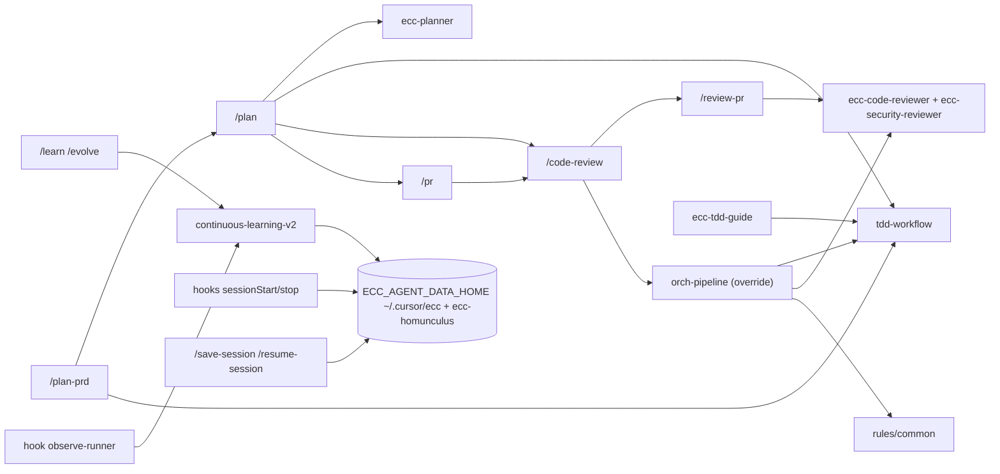

# План: форк ECC → Cursor Plugin «ecc-cursor»

Основа: [docs/cursor-plugin/ECC-CURSOR-GAP-MAP.md](ECC-CURSOR-GAP-MAP.md), сверена с кодом и документацией Cursor 19.11.2026 (6 исследовательских треков). Решённые развилки: имя `ecc-cursor`; один монолитный плагин; публикация в orphan-ветку `cursor-plugin-dist`; публичный Marketplace — не цель; команды остаются командами (вариант A).

## 0. Расхождения с картой разрыва (проверено по коду, верить этим числам)

- Правила: в `rules/` **122** файла (121 правило + README), `paths:` имеют **111** (не 82; 82 не воспроизводится), 11 без frontmatter (10 `rules/common/*` + README). В `.cursor/rules` — 39 нативных (30 с `globs`, 9 common с `alwaysApply: true`).
- Хуки: `scripts/hooks/` = **61 .js** (не 49); на Claude-пути достижимо ~43 (~36 поведенческих), через Cursor-адаптер — **15** (не 16). «21 не перенесён» → ~22–25 (добавить: `auto-tmux-dev`, `post-edit-typecheck` свёрнут в `stop-format-typecheck`, `pre-bash-dev-server-block` подключен, но win32-выключен; 4 хука покрыты inline частично).
- В upstream-адаптере `.cursor/hooks.json` **нет события `preToolUse` вообще** — поэтому config-protection/gateguard/doc-file-warning не перенесены. В плагине они едут на `preToolUse` (matcher `Write`).
- Профиль `full` = **36 модулей** (не 33); всего 49 модулей / 96 компонентов / 7 профилей. Модуль `orchestration` имеет targets claude/codex/opencode — **cursor намеренно нет** (решаем override'ом, см. разделы 2/4/7); `config-health` — claude-only.
- Скиллы `hermes-imports`, `openclaw-persona-forge`, `deepseek-harness-setup`, `dmux-workflows`, `config-health` **существуют** (карта сомневалась) — все 5 исключаем (dmux-workflows — см. override в разделе 2: исключён внутри включённого модуля).
- `${CLAUDE_PLUGIN_ROOT}` в agents/commands/skills/rules: **8 файлов / 12 вхождений** (не 20/54 — то было по всему дереву с docs/tests).
- `mcp__` в `skills/`: 4 файла / 10 вхождений; по ACSR — 11/42.
- `.claude/`: команды 42/189 (не 165), скиллы 51/217 (не 205), scripts/hooks 8/9 (не 13/41).
- `subagent_type|Task tool`: 12 файлов / 20 вхождений по ACSR; в `agents/` — **0** (живёт в 5 командах, 6 скиллах, 1 правиле).
- Тестов чужих платформ: 78–196 файлов в зависимости от скоупа (не ~50).
- CLv2: фоновый observer **не работает на нативном Windows** (upstream issue #2489, Job Object); наблюдение — bash `observe.sh`; анализ — Python `instinct-cli.py`. Хранилище v2.1 уже вне `~/.claude` (`${XDG_DATA_HOME:-~/.local/share}/ecc-homunculus`, оверрайд `CLV2_HOMUNCULUS_DIR`).
- Дрейф hook-id: `pre:observe` (run-with-flags) vs `pre:observe:continuous-learning` (metadata) — унифицировать в hook-map.
- Базовая линия `npm test` на Windows: 9974/10015, 41 падение в 10 файлах (~58 мин без пула; один opencode-тест ~28 мин; antigravity-lifecycle EPERM symlink без Developer Mode).

## 1. Решение о поставке

- **Основной путь — Cursor Plugin `ecc-cursor`**, собранный из исходников ECC сборщиком в `build/cursor-plugin/ecc-cursor/` (в `.gitignore`, строка 52). Установка: Customize → Plugins → From GitHub Repository; dev: копия в `~/.cursor/plugins/local/ecc-cursor` + Reload Window; headless: `agent --plugin-dir build/cursor-plugin/ecc-cursor`.
- **`install.ps1 --target cursor` оставляем upstream как есть; свой install-target НЕ делаем.** Аргументы: (a) README upstream сам называет cursor-адаптер beta/capability-limited; (b) плагин даёт Customize-UI, Refresh-обновления, чистое удаление и область user/project — копирование 1388 файлов этого не даёт никогда; (c) 0 правок upstream = чистый merge; (d) одна каноническая поставка вместо двух конкурирующих; (e) legacy-установки обрабатывает детектор двойной загрузки (раздел 6) + инструкция удаления в DIFFERENCES.md.
- Плагин **не пишет проектные файлы** при установке. `.cursor/cli.json`, `sandbox.json`, `.cursorignore`, `AGENTS.md` — скилл `/ecc-project-setup` (`disable-model-invocation: true`) по явному вызову (раздел 4).

## 2. Структура плагина (монолит)

Слой в репо (всё новое, upstream не трогаем):

- `cursor-plugin/` — `plugin.template.json`, `maps/` (exclusions.json, module-target-overrides.json, agent-names.json, path-map.json, tool-map.json, hook-map.json), `overrides/`, `hooks-src/` (run.js, adapter-full.js, probe.js), `README.template.md`.
- `scripts/cursor-plugin/` — build.js, validate.js, check-links.js, generate-hooks.js, install-local.js, publish-branch.js, gen-docs.js, changelog-check.js, check-doc-links.js.
- `scripts/lib/cursor-plugin/` — transforms.js, rules.js, agent-emit-cursor.js, tool-map.js, skills.js, commands.js.
- `tests/cursor-plugin/*.test.js` — подхватывается `tests/run-all.js` (glob `tests/**/*.test.js`).
- `docs/cursor-plugin/` — PLAN.md, VERIFY.md, UPSTREAM.md, UPSTREAM-TOUCHES.md, SYNC.md, HOOKS.md, DIFFERENCES.md, MULTITASK.md, TROUBLESHOOTING.md, CONTRIBUTING.md, CHANGELOG.md, `reference/` (GENERATED).
- `.github/README.md` + `.github/workflows/cursor-plugin.yml`.

Решение по модулю `orchestration` (targets upstream без cursor): **включаем его компоненты в сборку через `maps/module-target-overrides.json`** — override таргета в нашем слое, upstream manifests (`manifests/install-*.json`) не трогаем. Основание: `orch-pipeline` и цепочка `/code-review` → `/orch-review` — ядро workflow ECC; исключение разорвало бы граф (orch → tdd-workflow, code-reviewer, rules/common). В сборку попадают harness-neutral node-скрипты оркестрации и orch-* компоненты; **`dmux-workflows` остаётся исключённым** (tmux-оркестрация поверх dmux, на Windows/Cursor не работает; замена — `/multitask`, worktrees, `/best-of-n` — зафиксировано в MULTITASK.md), ссылки на него в командах/скиллах заменяются трансформом. Чужие платформенные скрипты модуля (`orchestrate-codex-worker.sh` и т.п.) отсекаются exclusions.json как раньше.

Дерево сборки `build/cursor-plugin/ecc-cursor/`:

- `.cursor-plugin/plugin.json` — name `ecc-cursor`, displayName, version 0.1.0, author balloutcode, repository, license MIT, keywords, category `developer-tools` (TODO(verify): поле недокументировано, но используется официальными плагинами), logo assets/logo.svg, **явные пути** rules/agents/skills/commands/hooks (тогда дефолтные папки не сканируются).
- `rules/*.mdc` — **121** правило: плоские имена с префиксом языка (как `createFlatRuleOperations` в `scripts/lib/install-targets/cursor-project.js`); `paths:` → `globs:`, description, `alwaysApply` (false при globs; true для 10 common — как в `.cursor/rules`). Формат `.mdc`, не `.md` (в project rules `.md` игнорируется).
- `agents/ecc-*.md` — **72** агента: `model: inherit`; `readonly: true` для 11 строгих (Read/Grep/Glob); `color` (5 агентов) отбрасываем; исходный `tools:` — абзацем в тело.
- `skills/<name>/SKILL.md` — **325** скиллов: 327 − 5 исключённых + 3 контекста `ecc-context-{dev,research,review}` (`disable-model-invocation: true`, эмуляция Custom Mode).
- `commands/*.md` — **110** команд: 98 + 12 legacy-шимов (тонкие алиасы на скиллы: tdd, e2e, verify…). 12 коллизий имён со скиллами переименованы в `ecc-<name>` (неймспейсинга в Cursor нет — подтверждённый баг/форум 162287).
- `hooks/hooks.json` + `hooks/run.js` + `hooks/adapter-full.js` — одна запись на событие, node сам читает `CURSOR_PLUGIN_ROOT`.
- `scripts/` (hooks, lib и прочие) — **require-замыкание по четырём корням графа**: (1) точки входа хуков из `run.js` (dispatcher-ы и скрипты по hook-map); (2) node-скрипты, на которые ссылаются скиллы (59 ссылок в 35 скиллах); (3) node-скрипты, на которые ссылаются команды (26 ссылок в 25 командах — команды тоже вызывают `node scripts/...`); (4) ссылки на `scripts/` в телах агентов (grep). Вычисляется графом `require`/вызовов, не списком; ожидание — **<150 файлов из 402**, точное число фиксируется в report.json и переносится сюда после первого build.
- `mcp.json` — только `chrome-devtools` (1:1 с корневым `.mcp.json` ECC, ноль секретов). Каталог 37 серверов — справочник `docs/reference/mcp.md` (фаза 9); context7/playwright, нужные агентам docs-lookup и e2e-runner, — инструкцией в теле этих агентов и в mcp.md (добавить в `.cursor/mcp.json` проекта). Отдельный `ecc-cursor-mcp` — не делаем (можно позже без переделок).
- `assets/logo.svg`, `README.md`, `CHANGELOG.md`, `LICENSE` (MIT, уведомление Affaan Mustafa), `docs/reference/` (фаза 9).

Размеры (замерено): rules 0.27 МБ, agents 0.46, commands 0.39, skills 5.31 (661 файл), scripts-замыкание ~2 МБ → **плагин ~8.5–9 МБ, ~1200 файлов**. Документированный лимит — только 10 МБ на marketplace.json; лимитов на число скиллов нет (TODO(verify) через замер).

- Риск «325 скиллов в контексте»: оценка ~325 × 40–80 токенов description ≈ 15–25k токенов. Митигация: ~70 языковым/фреймворковым скиллам добавляем `paths:` по globs одноимённых правил (Cursor поддерживает `paths` в SKILL.md); замер в фазе 1 (видимость в Customize, латентность) и фазе 4; если Cursor деградирует — запасной план разбиения готов (check-links уже считает замкнутость: каждый пакет ссылается только на себя или ядро).

## 3. Распространение и обновления

- **Orphan-ветка `cursor-plugin-dist`** (своя история, пишет только `publish-branch.js`; main не содержит сгенерированного → markdownlint `**/*.md` и валидаторы upstream сборку не видят, merge-конфликтов нет):
  - `.cursor-plugin/marketplace.json` — name `ecc-cursor`, owner {name: balloutcode, url}, plugins: [{name `ecc-cursor`, source `./ecc-cursor`, description, version, license MIT, keywords, category}] (паттерн cursor/plugin-template).
  - `ecc-cursor/` — копия сборки.
  - Коммит: `ecc-cursor <semver> (upstream <sha7>, main <sha7>)`; тег `ecc-cursor-v<semver>` (НЕ `v*` — на `v*` реагирует release.yml с NPM_TOKEN).
- **Установка**: Customize → Plugins → From GitHub Repository → `https://github.com/balloutcode/ecc-cursor`. TODO(verify) в фазе 8: умеет ли IDE выбрать ветку; если нет — CLI `agent plugin marketplace add <url> --git-ref cursor-plugin-dist` (команда реальна, но недокументирована) и/или запасной репо `balloutcode/ecc-cursor-dist` тем же скриптом (режим `--repo`; нужен PAT-секрет).
- **Обновление**: push в ветку → Refresh в Customize (для team marketplace Auto Refresh ≤10 мин); локальный dev — install-local + Reload Window; Cloud Agent держит старую версию до перезапуска. Семантика поля `version` недокументирована → своя semver в plugin.json + CHANGELOG с SHA upstream (major = удаление/переименование компонента или смена формата config; minor = новые компоненты, в т.ч. из upstream; patch = фиксы). Локальная копия проигрывает marketplace-версии с тем же именем — документировать.
- Публичный Marketplace — не цель; `validate.js` повторяет его чек-лист (name kebab-case, пути относительные без `..`, валидный frontmatter у каждого компонента, skill name == папка, README, все `${VAR}` из mcp.json объявлены в variables) — подать заявку можно позже без переделок.

## 4. Матрица разрыва по компонентам

- Правила (121): **transform** — paths→globs, нативная копия из `.cursor/rules` где есть (39), ссылки `.claude/rules` → имена правил плагина. S.
- Контексты (3): **emulate** — скиллы `ecc-context-*` с disable-model-invocation (включаются как Custom Mode / по вызову). S.
- Агенты (72): **transform** — эмиттер `agent-emit-cursor.js` поверх `agent-ir.js` (образец `agent-emit-pi.js`), tool-map отдельный (`agent-tool-map.js` не трогаем). M.
- Скиллы (322+3): **transform** — path-map, ссылки на агентов → ecc-*, frontmatter-чистка, `paths:` для ~70 lang-скиллов, node-скрипты скиллов в сборку (корень замыкания №2). M.
- Команды (110): **transform** + **emulate** для multi-\* — $ARGUMENTS → «Аргументы: текст после /команды», argument-hint → description, коллизии → ecc-префикс, цепочки сохранены; node-скрипты команд в сборку (корень замыкания №3). L.
- Модуль orchestration: **include-override через maps** (не исключаем) — orch-pipeline и оркестрационные команды/скиллы замкнуты; `dmux-workflows` — исключён с заменой ссылок. S.
- Хуки: **transform + emulate** — раздел 5. L.
- Память/сессии/CLv2: **transform** — пути в `ECC_AGENT_DATA_HOME` (default `~/.cursor/ecc`), observe.sh → node-порт; observer daemon → **impossible** на win32 (fallback: анализ на stop/sessionEnd через evaluate-session). M.
- MCP: **1:1 минимум** (chrome-devtools) + справочник каталога. S.
- Проектные файлы (.cursor/cli.json, sandbox.json, .cursorignore, AGENTS.md): **emulate** — скилл `/ecc-project-setup` по вызову. S.
- Statusline (`ecc-statusline.js`): **impossible** в IDE; опционально для Cursor CLI через `/ecc-project-setup`. S.
- Dashboard / ecc2 (Rust): **1:1** — инструменты репо, запуск из форка, не поверхность плагина. S.
- Scripts: **require-замыкание по 4 корням** (хуки + скиллы + команды + агенты). M.
- AGENTS.md/CLAUDE.md проекта: намеренно не ставятся; `/ecc-project-setup` по запросу. —

## 5. Хуки

Формат: каждая запись `hooks/hooks.json` плагина → `run.js <event>`. Раскрытие `${CURSOR_PLUGIN_ROOT}` в команде хука под PowerShell недокументировано; cwd stop/subagentStop = корень workspace. Две формы команды проверяются probe-хуком фазы 1 на Windows на 4 событиях (sessionStart, preToolUse, stop, subagentStop):

- A: `node -e "require(require('path').join(process.env.CURSOR_PLUGIN_ROOT,'hooks','run.js'))" <event>` — не зависит ни от cwd, ни от шелла (фаворит). При `-e` событие приходит в `process.argv[1]`.
- B: `node ./hooks/run.js <event>` (cwd = папка плагина) — при запуске файла событие приходит в `process.argv[2]`; для stop/subagentStop (cwd = корень workspace) форма B не подходит.
- **Решение по argv**: `run.js` всегда берёт событие как `process.argv.at(-1)` — одинаково работает в обеих формах (и в A, и в B); probe фиксирует фактические argv/cwd/env в `~/.cursor/ecc/probe.log`.

`run.js` выставляет `CLAUDE_PLUGIN_ROOT` и `ECC_PLUGIN_ROOT` = `CURSOR_PLUGIN_ROOT` → `resolve-ecc-root.js` находит корень по первой же ветке, **все скрипты ECC переиспользуются без правок**. Project dir: `CURSOR_PROJECT_DIR` и alias `CLAUDE_PROJECT_DIR` — **TODO(verify)** (семантика недокументирована: всегда ли установлен и равен ли корню workspace); probe логирует наличие/значение. `run.js` резолвит project dir по цепочке: `process.env.CURSOR_PROJECT_DIR` → `workspace_roots[0]` из payload хука → `process.cwd()`, и выставляет `CLAUDE_PROJECT_DIR` уже в резолвленное значение (для stop/subagentStop cwd = корень workspace, так что третья ветка там корректна).

`adapter-full.js` (поверх `.cursor/hooks/adapter.js`, upstream не менять): имена инструментов Cursor → Claude (Shell→Bash и т.д.), outputs Claude (`hookSpecificOutput.permissionDecision/updatedInput/additionalContext`) → Cursor (`permission/updated_input/additional_context/followup_message`), exit 2 = deny.

Профиль хуков (аналог userConfig из `.claude-plugin/plugin.json`): `hook-flags.js` уже понимает `ECC_HOOKS_ENABLED` / `ECC_HOOK_PROFILE` / `ECC_DISABLED_HOOKS` / `ECC_HOOK_CONFIG`; `run.js` подставляет `ECC_HOOK_CONFIG` → `~/.cursor/ecc/setup.json` (НЕ `<pluginRoot>/ecc/setup.json` — папка плагина перезаписывается обновлением); `sessionStart` дополнительно читает `~/.cursor/ecc/config.json` и экспортирует профиль через session-scoped `env`.

Генерация: `generate-hooks.js` строит hooks.json плагина из `hooks/hooks.json` + `hooks/hooks.metadata.json` по `maps/hook-map.json`; идемпотентен (`--check` в CI); унифицирует дрейф `pre:observe`.

Карта hook-id → событие Cursor → статус (полная — 36 поведенческих + 8 cursor-only; фолбэки):

- `session:start`, `session-start:plan-canvas-sessions` → sessionStart → 1:1 (env + additional_context; первым — `cursor-session-env`).
- `prompt:hookify-runtime`, `user-prompt:context-gate` → beforeSubmitPrompt → **degrade**: доступны только `continue`/`user_message`, контекст не вставить → предупреждениями; основная вставка контекста — sessionStart/postToolUse `additional_context`.
- `pre:bash:dispatcher` (block-no-verify, commit-quality, gateguard, git-push-reminder, tmux-reminder, auto-tmux-dev) + `pre:powershell:gateguard-fact-force` → beforeShellExecution (matcher по regex команды) → перенос через тот же dispatcher; tmux-trio и dev-server-block на win32 выключены (как в upstream).
- `pre:write:doc-file-warning`, `pre:edit-write:suggest-compact`, `pre:config-protection`, `pre:edit-write:gateguard-fact-force`, `pre:governance-capture`, `pre:hookify-runtime`, `pre:observe:continuous-learning` → **preToolUse** (matcher `Write`, `Shell|Write`, `*`) → перенос (permission deny + user_message + updated_input); observe — node-порт, бюджет <1 c или detached.
- `pre:mcp-health-check` → beforeMCPExecution / preToolUse `MCP:*` → перенос.
- PostToolUse sync-семейство (`post:hookify-runtime`, design-quality, edit-accumulator, console-warn, governance-capture, session-activity-tracker, ecc-metrics-bridge, ecc-context-monitor) → postToolUse `*` + afterFileEdit → перенос через `posttooluse-dispatcher` (sync-фаза).
- PostToolUse async-семейство (post-bash dispatcher, `post:quality-gate`, `post:observe`, `post:skill:track`) → postToolUse / afterShellExecution → **emulate**: async в Cursor нет → скрипты быстрые или отсоединённые (detached node), иначе impossible.
- `post:skill:track` → PostToolUseFailure matcher `Skill` в Cursor отсутствует → **фолбэк**: afterAgentResponse + разбор `CURSOR_TRANSCRIPT_PATH` (TODO(verify)); иначе impossible с записью.
- `post:mcp-health-check` → postToolUseFailure / afterMCPExecution → перенос.
- `pre:compact` → preCompact → 1:1 (наблюдение + user_message).
- `stop:*` ×8 (hookify-runtime, plan-canvas-pending, format-typecheck, check-console-log, session-end, evaluate-session, cost-tracker, desktop-notify) → stop → перенос (cwd=workspace им подходит; `loop_limit` не задаём — default 5 не трогаем, followup_message не используем); desktop-notify → win32 Toast opt-in, default off.
- `session:end:marker` → sessionEnd → 1:1.
- Cursor-only guards адаптера (pre:read:sensitive-file-warning, pre:prompt:secret-warning, pre/post:mcp:audit, tab ×2, subagent audit ×2, pre:bash:dev-server-block) → сохранить 1:1.
- Impossible/degraded (с причинами в HOOKS.md): observer-daemon на win32; `skill:track` без фолбэка; prompt-вставка контекста; statusline (не хук).

## 6. Двойная загрузка

Third-Party Imports включён по умолчанию и подгружает хуки из **проектного `.claude/settings.json` → `.claude/settings.local.json` → `~/.claude/settings.json`** (в этой последовательности, низший приоритет). Детектор в `sessionStart` плагина:

- Проект установлен через `--target cursor`: существует `.cursor/hooks.json` с ссылками на `.cursor/hooks/adapter.js` И/ИЛИ `.cursor/agents/ecc-*.md`.
- `.claude/settings.json` (проектный и `~/.claude`) содержит ECC-команды хуков (`plugin-hook-bootstrap`, `run-with-flags`, `scripts/hooks/`).
- Claude-плагин `ecc` присутствует (`~/.claude/plugins/**ecc**`).

Действия:

- `additional_context` с предупреждением и точными шагами удаления (какие файлы стереть / выключить Third-Party Imports в Settings → Agents / конфликт с Claude-плагином `ecc`).
- **Дедупликация по hook-id, а не по событию целиком**: `run.js` читает проектный `.cursor/hooks.json` legacy-адаптера, сопоставляет его записи с `maps/hook-map.json` (запись адаптера → вызываемые скрипты → набор hook-id) и пропускает **только пересекающиеся id**; остальные id того же события продолжают работать (плагин выполняется после project-хуков — двойной записи/блокировок не будет). Каждый пропущенный id пишется в лог (`~/.cursor/ecc/hooks.log`) с причиной «covered by project adapter».
- Тест дедупликации: фикстура «адаптер покрывает 15 из N» — плагин выполняет ровно N−15 id, пропущенные 15 перечислены в логе, события с частичным покрытием не отключены целиком.
- Полный off-switch плагиновых хуков без удаления плагина: `ECC_HOOKS_ENABLED=0` или `hooks.enabled=false` в `~/.cursor/ecc/setup.json`.

## 7. Карта зависимостей и порядок фаз

Связи (grep по точным именам; числа карты подтверждены структурно): команды→команды 133 в 61, команда→агенты 52 в 31, скиллы→скиллы 632 в 184, скиллы→агенты 112 в 37, rules→скиллы 91 в 59, rules→агенты 29 в 11, команды→скрипты 26 в 25, скиллы→скрипты 59 в 35. Топ-узлы: security-reviewer (31), code-reviewer (23), planner (18), tdd-guide (15); accessibility (35), security-review (35), verification-loop (30), tdd-workflow (27). Неймспейсинга и зависимостей между плагинами нет → все связи замыкаем внутри монолита; check-links (fail-режим с фазы 5) это доказывает.

Замкнутые группы → порядок фаз:

- G0 Сборка (build/validate/check-links/generate-hooks/probe, module-target-overrides) → фаза 1.
- G1 Правила+контексты (листья графа) → фаза 2, параллельно с G5.
- G2 Агенты (+agent-names.json для фаз 4–5) → фаза 3.
- G3 Скиллы → фаза 4 (нужен agent-names).
- G4 Команды и цепочки → фаза 5 (нужны G2, G3).
- G5 Хуки (run.js, adapter-full, generate-hooks) → фаза 6, параллельно с G1 (разные файлы).
- G6 Память/CLv2 → фаза 7 (нужны G3, G4, G5).
- G7 MCP, /ecc-project-setup, публикация, CI, sync → фаза 8; G8 Документация → фаза 9.

Orchestration-override влияет на граф: `orch-pipeline` (включён override'ом) остаётся узлом G4/G3, его связи на tdd-workflow, reviewers и rules/common замкнуты; `dmux-workflows` из графа убран, его роль — у `/multitask` и worktrees (MULTITASK.md).

Параллелизация: **Build in Parallel** из PLAN.md — фазы 2 и 6 (независимые файлы). **/multitask** («each in its own environment») — внутри фаз 2 (пакеты правил по языкам) и 4 (пакеты скиллов по ~40 папок), только когда общий трансформер уже готов и заморожен. **Не использовать** /multitask в фазах 1, 3, 5, 6 (общий код, цепочки зависимостей). **/best-of-n** — опционально для эмиттера агентов (фаза 3) и adapter-full (фаза 6). **worktree** — изоляция фазы целиком по желанию. Сабагенты наследуют модель родителя и тратят токены отдельно; вложенность ограничена (внук не запускает сабагентов).

## 8. Нейтрализация Claude-специфики (замерено на 3f14a103)

Формат: что → файлов/вхождений → замена.

- `model:` в агентах → 72/72 (sonnet 62, opus 4, haiku 6) → `model: inherit`; упоминания sonnet/opus/haiku в тексте → 98 файлов/132 → «основная модель».
- `tools:` в агентах → 72 → `readonly: true` для 11 строгих (planner, architect, code-explorer, comment-analyzer, conversation-analyzer, healthcare-reviewer, homelab-architect, network-architect, network-config-reviewer, bengali-reviewer, type-design-analyzer); список — в тело; `mcp__context7__*`/`mcp__playwright__*` (в 2–3 агентах) → убрать, требование MCP в тело + mcp.md.
- `color:` в 5 агентах (gan-*, harness-optimizer, loop-operator) → отбросить.
- `$ARGUMENTS` → команды 33/73, скиллы 2/3 → блок «Аргументы: текст после /команды»; `argument-hint` 16 → в description.
- `allowed-tools` → 2 скилла (inherit-legacy-style, videodb) → удалить, рекомендацией в тело.
- `.claude/` → команды 42/189, скиллы 51/217, rules 18/35, agents 3/4, scripts/hooks 8/9 → path-map.json; `.claude/plans|prds|PRPs|reviews` → **`.ecc/plans|prds|reviews`** (нейтральная project-папка артефактов; не `.claude`, не `.cursor`); `~/.claude/skills/learned` → `<ECC_AGENT_DATA_HOME>/skills/learned` + зеркало в `~/.cursor/skills/learned/` (Cursor читает сам) — **зеркало пишет только файлы с префиксом `ecc-learned-`**, ничего чужого не перезаписывает и не удаляет (удаление — только своих `ecc-learned-*`); политика фиксируется в DIFFERENCES.md и VERIFY.md; `~/.claude/session-data` → `<ECC_AGENT_DATA_HOME>/session-data`.
- `${CLAUDE_PLUGIN_ROOT}` → 8/12 (ACSR) → пути внутри плагина; скрипты получают `ECC_PLUGIN_ROOT` от run.js/sessionStart env.
- `~/.claude/settings.json` → 31 файл/36 → по смыслу: хуки — `~/.cursor/ecc/setup.json`; UI — Customize.
- `CLAUDE.md` → 36/109 → AGENTS.md / правило.
- «Claude Code» → 85/178 → «агент»/«Cursor» (allowlist для DIFFERENCES/TROUBLESHOOTING).
- `CLAUDE_*` env в scripts/ → 71/227 → run.js выставляет совместимые (`CLAUDE_PLUGIN_ROOT`, `CLAUDE_PROJECT_DIR` = резолвленный project dir, см. раздел 5); новый код — только CURSOR_*/ECC_*.
- Task tool / subagent_type → 12 файлов/20 (команды gan-build, multi-execute, multi-plan, plan, santa-loop; скиллы 6; rules/common/agents.md) → «делегируй сабагенту ecc-X».
- TodoWrite/WebFetch/WebSearch/NotebookEdit/MultiEdit → 17/55 → нейтральные имена (MultiEdit→Edit, TodoWrite→«список задач агента»).
- `mcp__server__tool` → 11/42 (ACSR) → «MCP-инструмент tool сервера server».
- `~/.claude/bin/codeagent-wrapper` → 6 команд/20 (multi-plan, multi-execute, multi-workflow, multi-backend, multi-frontend, santa-loop) → переписать на сабагентов плагина (фоновые/параллельные, «each in its own environment»); ссылок на Codex/Antigravity быть не должно.
- Statusline → ecc-statusline.js в IDE impossible; CLI-вариант в /ecc-project-setup.
- Bash-сниппеты в markdown → ~66 команд (~180 блоков), ~190 файлов скиллов (~490 блоков) → политика: агент на Windows сам переводит под PowerShell (проверка вручную в фазах 5/7); точечно переписываем критичные (sessions.md 13, git-workflow 18, configure-ecc 12, prp-implement 11, autonomous-loops 11, pm2 9); bash-хуки (`observe.sh`, `migrate-homunculus.sh`) → node-порты.
- Python `instinct-cli.py` → оставить Python с детекцией `py`/`python` и честным prerequisite; провал детекции = понятное сообщение, не падение.

## 9. Исключения других платформ

Механизм: `cursor-plugin/maps/exclusions.json` → сборщик пропускает пути и пишет каждый пропуск в report.json с причиной; тест `build.test.js` проверяет, что исключённого нет в сборке. Из репо **ничего не удаляется** (merge с upstream чистый).

- Папки платформ: .kiro (155), .opencode (85), pi/ (223), .agents (119) и ~38 мелких (.codex, .codex-plugin, .codebuddy, .gemini, .grok-plugin, .hermes, .kimi, .openclaw, .pi, .qoder-plugin, .qwen, .trae, .zed, .adal, hooks/hermes) — ≈620 файлов.
- Скиллы: hermes-imports, openclaw-persona-forge, deepseek-harness-setup, config-health и **dmux-workflows** (последний — внутри включённого override'ом модуля orchestration; остальные 4 — целиком чужие платформы/claude-only). Все 5 существуют — подтверждено.
- Скрипты: codex/, codex-git-hooks/, sync-ecc-to-codex.sh, orchestrate-codex-worker.sh, build-opencode.js, build-pi-core.js, *-adapt-agents.js, grok-install.js + scripts/lib {agent-emit-pi, antigravity-*, codex-*, grok-*, opencode-paths}.js — не попадают в runtime через require-граф автоматически.
- Тесты чужих платформ (78–196 файлов) — остаются: `npm test` upstream должен быть зелёным.

## 10. Upstream sync

- `git fetch upstream --no-tags` → `git merge upstream/main` в main (push в upstream = DISABLE; теги `v*` не скачиваем/не пушим — release.yml).
- После merge: пересборка → **drift-тест** (CI): новый агент/скилл/команда/правило/hook-id upstream без записи в maps/ → падение со списком. Новые upstream-компоненты осознанно добавляем в maps (или в exclusions с причиной; если upstream добавит target cursor в модули — пересмотреть module-target-overrides).
- CHANGELOG: заголовок `## [<semver>] — дата — upstream affaan-m/ECC@<sha7>`, раздел Upstream (диапазон SHA, новые компоненты по drift-отчёту); changelog-check сверяет версию и SHA с plugin.template.json и UPSTREAM.md.
- Правки upstream-файлов — цель 0; любая вынужденная правка 1–5 строк → запись в UPSTREAM-TOUCHES.md (файл, строки, зачем); CI-отчёт.

## 11. Фазы 1–9 (режим, Done-when, ручные проверки на Windows)

Общее: ветка `cursor-plugin/phase-N` на фазу; тесты — `$env:ECC_TEST_ONLY='cursor-plugin'; node tests/run-all.js` для итераций, полный `npm test` сравнивать с базовой линией **9974/10015 (41 падение в 10 файлов, список из отчёта Шага 0)** — «не хуже базовой»; `npm run lint` зелёный. Сборка детерминирована (два запуска → побайтно равны). **`npm ci`/`npm test` могут менять `yarn.lock`** (репо yarn-canonical): после прогонов — `git restore yarn.lock`, не коммитить его. **В коммитах — никаких личных путей и эмодзи.**

- **Фаза 1 — сборка и пробный плагин** (Agent). build.js (профиль full = 36 модулей, минус exclusions, плюс module-target-overrides), transforms identity, report.json, validate.js, check-links.js (warn), generate-hooks.js, probe.js (4 события × 2 формы команды → `~/.cursor/ecc/probe.log`: cwd, argv, `CURSOR_PLUGIN_ROOT`, `CURSOR_PROJECT_DIR`, `workspace_roots`, платформа), install-local.js. Done-when: build+validate код 0; report.json: rules 121, agents 72, skills 322, commands 110, overrides: `orchestration → include` / `dmux-workflows → exclude`, scripts-замыкание N **по 4 корням (хуки + скиллы + команды + агенты)**, ожидание <150 файлов — точное N фиксируется и переносится в PLAN.md; ECC_TEST_ONLY зелёный; `npm test` не хуже базовой. Руками: install-local → Reload Window → плагин виден в Customize без ошибок, Output → Hooks чистый, probe.log показывает рабочую форму команды для каждого события (и argv[1] vs argv[2]) → запись в VERIFY.md, выбранная форма → в PLAN.md; замер латентности Customize с 322 скиллами → VERIFY.md.
- **Фаза 2 — правила и контексты** (Build in Parallel с фазой 6; внутри — /multitask пакетами по языкам после заморозки rules.js). Done-when: 121/121 `.mdc` с валидным frontmatter (где есть нативная копия `.cursor/rules` — использована), 0 `paths:`, 0 `.claude/`, 3 контекст-скилла, name == папка; check-links по правилам 0. Руками: правило typescript подхватывается при открытии .ts файла.
- **Фаза 3 — агенты** (Agent; /best-of-n опционально для эмиттера). agent-emit-cursor.js на agent-ir, tool-map.js, agent-names.json (72). Done-when: 72/72 валидны; 0 `model: sonnet|opus|haiku|fable`, 0 `claude-` id; readonly ровно у 11; ссылки агент→агент и правило→агент (36+11 файлов) на ecc-* валидны. Руками: агенты видны в Customize → Subagents, `ecc-planner` вызывается из чата.
- **Фаза 4 — скиллы** (Agent + /multitask пакетами ~40 папок с изоляцией). skills.js + path-map.json (тест на каждое правило). Done-when: 325 скиллов (322+3); 0 `.claude/` вне allowlist, 0 `$ARGUMENTS`, 0 `allowed-tools`, 0 `${CLAUDE_PLUGIN_ROOT}`, 0 битых ссылок скилл→скилл (632 связи сохранены); ~70 lang-скиллов с `paths:`; **node-скрипты скиллов (59 ссылок/35 скиллов) в сборке** — check-links + тест существования файлов (корень замыкания №2). Руками: 3 случайных скилла вызываются через `/имя`.
- **Фаза 5 — команды и цепочки** (Agent; /multitask НЕ использовать). Done-when: 110 команд; 0 `$ARGUMENTS`, 0 `codeagent-wrapper`, 0 ссылок на .ccg/prompts; 12 коллизий → ecc-*; 12 legacy-шимов-алиасов; multi-\*+santa-loop переписаны на сабагентов; **node-скрипты команд (26 ссылок/25 команд) в сборке** (корень замыкания №3); тест цепочки `/plan-prd → /plan → tdd-workflow → /code-review → /pr` (все узлы в сборке); check-links в fail-режиме зелёный. Руками: `/plan` и `/code-review` запускаются и ссылаются на существующих ecc-агентов; bash-сниппеты критичных команд проверены под PowerShell.
- **Фаза 6 — хуки плагина** (параллельно с фазой 2 или отдельный worktree). run.js (event через `process.argv.at(-1)`, project dir по цепочке с фолбэком) + adapter-full.js + generate-hooks.js; перенос 21+ недостающего; профили minimal/standard/strict; детектор двойной загрузки с **дедупликацией по hook-id** и логом пропущенных id. Done-when: каждый из ~36 поведенческих hook-id либо достижим из hooks.json плагина, либо impossible с причиной и фолбэком; тест «адаптер покрывает 15 из N» зелёный; `node scripts/ci/validate-hooks.js` и тесты (по образцу `tests/hooks/cursor-hook-dispatchers.test.js`, payload-ы Cursor, win32+posix) зелёные; generate-hooks `--check` без diff. Руками: хуки видны в Customize → Hooks; `git commit --no-verify` реально блокируется block-no-verify (exit 2); Output → Hooks без ошибок; смена профиля через `~/.cursor/ecc/setup.json` работает.
- **Фаза 7 — память и CLv2** (Agent). node-порт observe, пути на ECC_AGENT_DATA_HOME, learned skills в `~/.cursor/skills/learned/` **только с префиксом `ecc-learned-`** (ничего чужого не перезаписывать, удаление — только своих; политика в DIFFERENCES.md и VERIFY.md), изоляция от Claude-установки (тест с двумя HOME). Done-when: e2e «сессия 1 → stop пишет сводку → сессия 2 → sessionStart подхватывает» зелёный на win32; `/save-session` `/resume-session` ссылаются только на ECC_AGENT_DATA_HOME; обновление плагина (install-local поверх) не стирает `~/.cursor/ecc`; тест: зеркало не трогает чужой скилл в `~/.cursor/skills/` и удаляет только `ecc-learned-*`; observer-daemon задокументирован impossible на win32 (#2489) с stop-time анализом; `py`/`python` детекция для instinct-cli. Руками: `/instinct-status` и `/evolve` отрабатывают.
- **Фаза 8 — MCP, проектная настройка, поставка, CI, sync** (Agent; Linux-часть CI можно через Cloud Agent). mcp.json (chrome-devtools), скилл `/ecc-project-setup`, publish-branch.js (orphan), cursor-plugin.yml (windows-latest + ubuntu-latest: npm ci; test:validators; ECC_TEST_ONLY; полный прогон с `ECC_TEST_JOBS=4` (2 на Windows) и `ECC_TEST_SERIAL` по grep-паттерну как в ci.yml; build/validate/check-links fail; детерминизм; generate-hooks --check; job timeout ≥70 мин на Windows), SYNC.md + drift-тест. Done-when: CI зелёный на обеих ОС; `git ls-remote … cursor-plugin-dist` видит ветку. Руками: установка из GitHub (ветка или запасной репо — результат проверки выбора ветки в IDE записан в VERIFY.md); Refresh приносит новую версию; агенты/скиллы/правила/хуки работают.
- **Фаза 9 — документация плагина** (Agent). gen-docs.js → reference/{agents,skills,commands,rules,hooks,mcp,excluded}.md (GENERATED, счётчики = report.json, `--check` в CI); проза: .github/README.md (stats-маркеры), README плагина, HOOKS.md, DIFFERENCES.md (2 сравнения: vs Claude Code ECC, vs `--target cursor`; **включая политику зеркала `ecc-learned-*`**), MULTITASK.md, TROUBLESHOOTING.md, CONTRIBUTING.md, CHANGELOG.md + changelog-check. Done-when: docs + docs:check код 0, повторный прогон без diff; сломанная строка в reference → docs:check падает; числа README = report.json = reference; check-doc-links 0 битых относительных ссылок; `npm run lint` зелёный. Руками: установка по README дословно на чистом Windows-профиле; docs/reference/ есть в установленном плагине.

## 12. Риски и TODO(verify)

- Раскрытие `${CURSOR_PLUGIN_ROOT}` в команде хука под PowerShell (документировано только для mcp.json; официальные плагины зовут bash — на Windows ломается) → probe в фазе 1; форма A не зависит от раскрытия.
- cwd stop/subagentStop = корень workspace (есть форум-репорт о нестабильности) → probe; run.js не зависит от cwd.
- `CURSOR_PROJECT_DIR` / `CLAUDE_PROJECT_DIR` — семантика недокументирована (всегда ли установлен, чему равен) → TODO(verify) через probe (логирует наличие и значение); фолбэк-цепочка `workspace_roots[0]` → cwd зашита в run.js.
- Лимиты на число скиллов/агентов/правил и влияние на контекст недокументированы → замер в фазе 1 (латентность Customize, видимость 322 скиллов) и фазе 4; митигация `paths:` + запасной план разбиения.
- Выбор ветки при Customize → From GitHub Repository недокументирован → проверка в фазе 8; фолбэки: CLI `--git-ref` (сам недокументирован) или репо `ecc-cursor-dist`.
- `displayName`/`category`/`tags` в plugin.json недокументированы (но используются официальными плагинами) → включить, поведение проверить в фазе 1.
- Семантика `version` при обновлении недокументирована → проверить Refresh циклом 0.1.0→0.1.1 в фазе 8.
- Неймспейсинга команд/скиллов/агентов нет (форум-баг 162287) → префиксы на коллизиях; риск конфликта с пользовательскими `/plan` и т.п. → документировать.
- `skill:track`: нет matcher `Skill` → фолбэк afterAgentResponse + `CURSOR_TRANSCRIPT_PATH` (verify), иначе impossible.
- Хук-файлы `.sh`/bun официальных плагинов не работают на Windows → наш node-run.js — обязательное условие; `node` в PATH — prerequisite (engines >=18), проверка в install-local.
- Плагиновые хуки нельзя выключить точечно из UI (недокументировано) → `ECC_HOOKS_ENABLED`/setup.json как off-switch.
- Антивирус/Defender и ~1200 файлов плагина: латентность первой индексации — замерить в фазе 8 на чистом профиле.
- Тест antigravity-lifecycle падает на EPERM symlink без Developer Mode — локальная особенность, в CI windows-latest ожидается зелёный (как в upstream ci.yml); не чинить, держать в списке базовой линии.
